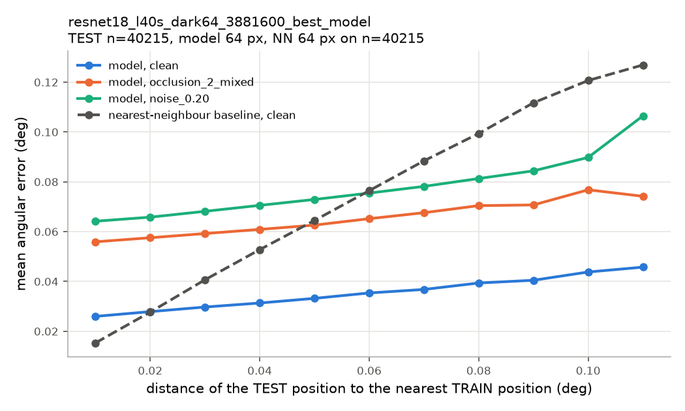
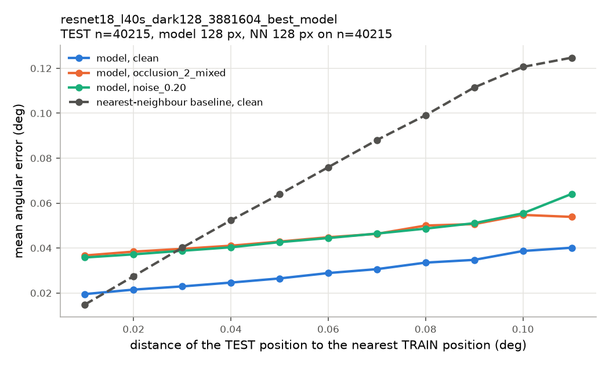
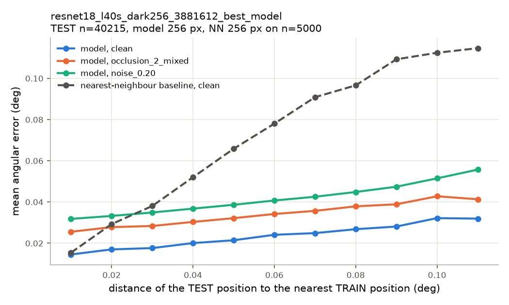
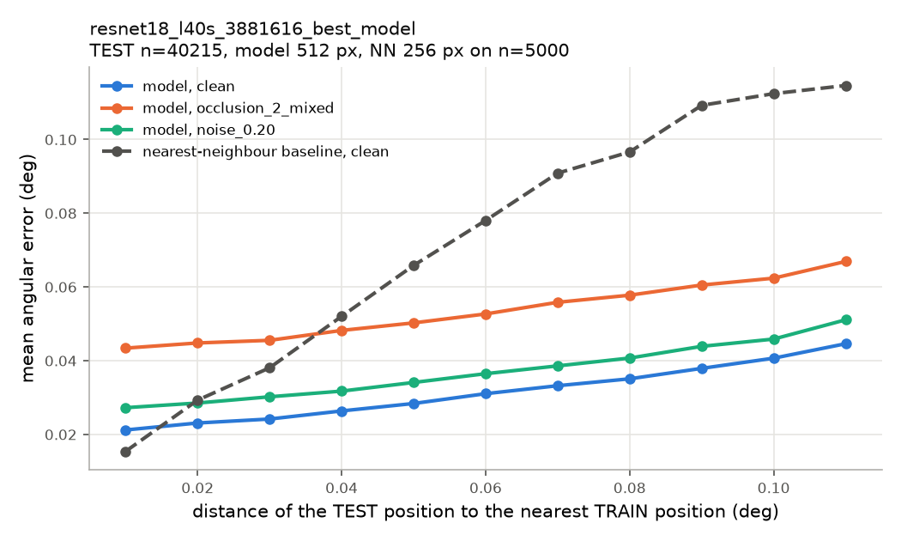
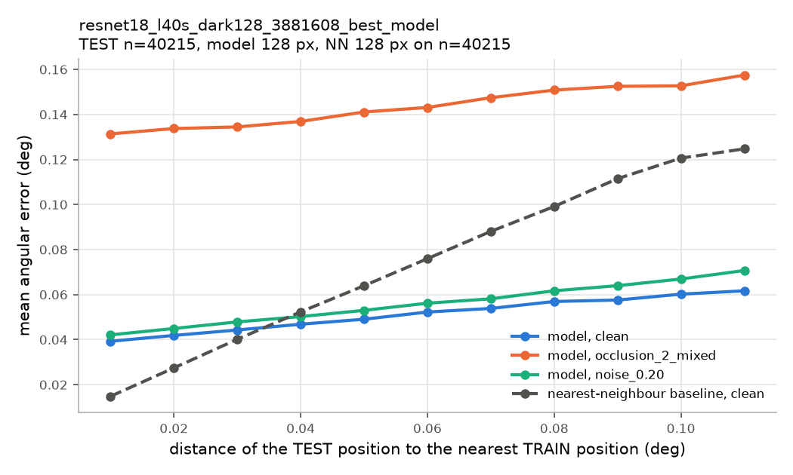

# Input resolution and architecture on the spatial hold-out split

Status 2026-09-11. Five models: ResNet-18 at 64, 128, 256 and 512 px, and the paper's MLP
(SimpleFC) at 128 px. All five were trained with one identical recipe. Occlusion boxes are drawn
per image with a random gray fill (section 1). An earlier recipe shared one set of boxes across
each batch; that bug and its fix are in section 7. All numbers below come from the corrected
recipe.

## 1. Setup

### Split

A random 80/20 split leaves every validation image 0.01° away from a training image. This split
removes whole squares of positions instead.

| Set | Positions | Share | Definition |
|---|---|---|---|
| TEST | 40,215 | 17.6% | Square holes of radius 0.10° around the 108 Algorithm 2 start origins, excluding (0, 0) |
| VAL | 19,800 | 8.7% | Holes of radius 0.07° around the 88 midpoints between origins |
| TRAIN | 168,785 | 73.8% | Everything else |

A TEST position lies 0.01–0.11° from the nearest TRAIN position.

### Models

| model | run | params | weights | RAM peak / forward | best val MSE | selected epoch |
|---|---|---|---|---|---|---|
| 64 px ResNet | r64_occ15-40img-rot90-fill0-255_n00-20_e98_hold_3881600 | 11.17 M | 42.7 MB | 90 / 13 MB | 3.23e-5 | 98 |
| 128 px ResNet | r128_occ15-40img-rot90-fill0-255_n00-20_e98_hold_3881604 | 11.17 M | 42.7 MB | 90 / 18 MB | 2.08e-5 | 91 |
| 256 px ResNet | r256_occ15-40img-rot90-fill0-255_n00-20_e98_hold_3881612 | 11.17 M | 42.7 MB | 90 / 21 MB | 1.61e-5 | 91 |
| 512 px ResNet | r512_occ15-40img-rot90-fill0-255_n00-20_e98_hold_3881616 | 11.17 M | 42.7 MB | 96 / 44 MB | 2.18e-5 | 98 |
| 128 px MLP | mlp_r128_occ15-40img-rot90-fill0-255_n00-20_e98_hold_3881608 | 17.05 M | 65.1 MB | 134 / 3 MB | 5.42e-5 | 98 |

- **RAM:** CPU float32 inference at batch 1 with 4 threads, matching the Pi 4. The peak includes
  loading the checkpoint; the forward figure is the forward pass alone. It was measured on x86, so
  only the increases carry over to the Pi.
- **Val MSE:** on normalized targets.

### Training recipe (identical for all five)

- **Data and selection:** trained on TRAIN, model selection on VAL, one training seed.
- **Optimizer:** batch 512, AdamW with lr 2.8e-3 and weight decay 1e-3, cosine warm restarts with
  T_0 = 7, 98 epochs, fp16.
- **Photometric augmentation, per image:** brightness ×[0.6, 1.4], contrast ×[0.9, 1.1], Gaussian
  noise with σ drawn from [0, 0.2].
- **Occlusion augmentation, per image:** 2 boxes, each applied with p 0.5. Each box has an edge of
  15–40% of the image, a rotation of ±90° and a gray fill drawn from 0–255.
- **Hardware:** 64 px, 128 px and the MLP trained on L40S and H200 GPUs. 256 and 512 px trained on
  an H200 with `torch.compile`.

### Evaluation

All evaluations read frames from the 512 px image bank. Each perturbation is applied to the 512 px
frame, which is then box-averaged to the model's input size and rounded to 8 bit. Every model
therefore sees the same boxes, factors and noise at the same start and step. Perturbed conditions
use 3 perturbation seeds; ± is the std over those seeds.

- **TEST open loop:** one prediction per TEST position (40,215), compared with its true tilt.
- **Nearest-neighbour (NN) baseline:** predicts the tilt of the most similar TRAIN image by L2
  distance at the model's resolution.
- **Closed loop from origins:** the Algorithm 2 replay started from the 108 origins, which lie in
  TEST holes and are never trained on. Stop at SSIM 0.97, at most 10 corrections.
- **Closed-loop sweep:** the replay from all 2,320 starts on the 0.1° grid, under 43 conditions.
  The 0.1° grid is the regular grid of start positions spaced 0.1° apart.
- **Noise curve:** the closed-loop sweep at σ = 0–0.4.
- **Grid by area:** the training job's clean closed loop on the 0.1° grid, run on the model's own
  bank and grouped by the split of each start position.

## 2. Findings

1. **256 px is the most accurate model.**
   - Clean: 0.020° TEST open-loop error and 0.009° closed-loop final error. This is the best clean
     result, and it holds at every distance from TRAIN.
   - Large occlusions: highest success, e.g. 93.1% with 2 gray 50% boxes and 91.4% with 2 bright
     50% boxes.
   - `combined_harsh`: 99.8% success.
2. **128 px is the most noise-robust model.**
   - From σ = 0.25 up it has the lowest closed-loop error, reaching 0.026° at σ = 0.4 against
     0.032° for 256 px.
   - Its clean error is 0.014° closed loop and 0.025° TEST, higher than 256 px.
   - Box-averaging from 512 to 128 px leaves about half the per-pixel noise that 256 px keeps
     (section 4).
3. **256 vs 128 px, for your decision:**
   - 256 px wins on clean accuracy and large occlusions.
   - 128 px wins only under strong noise (σ ≥ 0.25). It uses the same 11.2 M parameters and slightly
     less forward-pass memory (18 vs 21 MB).
   - Both reach 100% success from the unseen origins in every closed-loop condition tested.
4. **512 px is no better than 256 px on clean frames and is worse under occlusion.**
   - Clean: 0.027° TEST and 0.016° closed loop.
   - Large occlusions: 68.9% with 2 gray 50% boxes, 67.5% with 2 bright 50% boxes.
   - Exception: on the open-loop TEST with strong noise or `combined_harsh` (0.086°) it has the
     lowest error.
5. **64 px is resolution-limited.**
   - Clean error is 0.032° TEST, and it is the only ResNet below 100% under brightness ×0.4 (89.5%).
   - `combined_harsh` drops it to 85.6% success.
6. **The MLP is clearly behind.**
   - Clean error is about 2× the 128 px ResNet (0.047° TEST vs 0.025°), barely better than the NN
     baseline (0.052°).
   - Occlusion breaks it: 60% success from the origins with 2 bright 30% boxes, and 37.6% on
     `combined_harsh` across the grid.
   - Its train/eval gap under occlusion remains (section 7), which points to the architecture rather
     than the recipe.
7. **The models generalise beyond lookup.**
   - The NN baseline's error grows with distance from TRAIN, from 0.015° to 0.12°.
   - Every ResNet beats the baseline from about 0.03° away. At 0.11° the 256 px model has 0.032°
     against the NN's 0.115°.
   - In the closed loop, starting inside a hole costs about 0.002–0.003° of final error.

## 3. Clean accuracy

### TEST open loop and nearest-neighbour baseline

Angular error (°) by distance to the nearest TRAIN position. Each cell is model / NN.

| model | TEST error | NN baseline | 0.01° | 0.03° | 0.05° | 0.07° | 0.09° | 0.11° |
|---|---|---|---|---|---|---|---|---|
| 64 px ResNet | 0.0316 | 0.0523 | 0.026 / 0.015 | 0.030 / 0.041 | 0.033 / 0.064 | 0.037 / 0.088 | 0.040 / 0.112 | 0.046 / 0.127 |
| 128 px ResNet | 0.0251 | 0.0518 | 0.019 / 0.015 | 0.023 / 0.040 | 0.026 / 0.064 | 0.031 / 0.088 | 0.035 / 0.111 | 0.040 / 0.125 |
| **256 px ResNet** | **0.0200** | 0.0524 | 0.015 / 0.015 | 0.018 / 0.038 | 0.021 / 0.066 | 0.025 / 0.091 | 0.028 / 0.109 | 0.032 / 0.115 |
| 512 px ResNet | 0.0269 | 0.0524 | 0.021 / 0.015 | 0.024 / 0.038 | 0.028 / 0.066 | 0.033 / 0.091 | 0.038 / 0.109 | 0.045 / 0.115 |
| 128 px MLP | 0.0468 | 0.0518 | 0.039 / 0.015 | 0.044 / 0.040 | 0.049 / 0.064 | 0.054 / 0.088 | 0.058 / 0.111 | 0.062 / 0.125 |

- **NN sample size:** all TEST positions at 64 and 128 px; 5,000 samples at 256 and 512 px.
- **NN resolution for 512 px:** 256 px, because 512 px does not fit in the eval job's memory.

### Closed loop from the 108 origins

Success [95% Wilson interval]; mean corrections; final error mean ± sd. One perturbation seed.

| condition | 64 px ResNet | 128 px ResNet | 256 px ResNet | 512 px ResNet | 128 px MLP |
|---|---|---|---|---|---|
| clean | 100% [96.6, 100]; 1.17; 0.023 ± 0.018° | 100% [96.6, 100]; 1.15; 0.020 ± 0.015° | 100% [96.6, 100]; 1.12; 0.018 ± 0.016° | 100% [96.6, 100]; 1.16; 0.023 ± 0.017° | 100% [96.6, 100]; 1.33; 0.033 ± 0.017° |
| noise σ 0.20 | 100% [96.6, 100]; 1.34; 0.036 ± 0.016° | 100% [96.6, 100]; 1.24; 0.024 ± 0.015° | 100% [96.6, 100]; 1.19; 0.026 ± 0.016° | 100% [96.6, 100]; 1.20; 0.025 ± 0.019° | 100% [96.6, 100]; 1.43; 0.028 ± 0.018° |
| 2 boxes 30% | 100% [96.6, 100]; 1.40; 0.027 ± 0.016° | 100% [96.6, 100]; 1.27; 0.025 ± 0.018° | 100% [96.6, 100]; 1.22; 0.019 ± 0.017° | 100% [96.6, 100]; 1.43; 0.028 ± 0.019° | 73.1% [64.1, 80.6]; 1.97; 0.101 ± 0.122° |
| 2 rotated bright boxes 30% | 100% [96.6, 100]; 1.37; 0.029 ± 0.017° | 100% [96.6, 100]; 1.29; 0.024 ± 0.016° | 100% [96.6, 100]; 1.20; 0.022 ± 0.018° | 100% [96.6, 100]; 1.28; 0.029 ± 0.019° | 60.2% [50.8, 68.9]; 2.29; 0.100 ± 0.083° |

### Grid closed loop by start area

Clean, 2,320 starts. Each cell is success; corrections; final error.

| model | TRAIN area (1,137) | VAL holes (352) | TEST holes (831) |
|---|---|---|---|
| 64 px ResNet | 100%; 1.11; 0.0134° | 100%; 1.15; 0.0145° | 100%; 1.18; 0.0147° |
| 128 px ResNet | 100%; 1.05; 0.0114° | 100%; 1.05; 0.0135° | 100%; 1.08; 0.0136° |
| **256 px ResNet** | 100%; 1.02; **0.0076°** | 100%; 1.02; **0.0097°** | 100%; 1.05; **0.0100°** |
| 512 px ResNet | 100%; 1.02; 0.0142° | 100%; 1.02; 0.0169° | 100%; 1.05; 0.0176° |
| 128 px MLP | 100%; 1.19; 0.0231° | 100%; 1.24; 0.0256° | 100%; 1.28; 0.0250° |

## 4. Noise robustness

### Noise curve

Closed-loop final error (°), 2,320 starts. ± is the std over 3 seeds and stays at 0.0004° or less;
σ = 0 is a single run. All runs reached 100% success.

| model | σ 0 | 0.05 | 0.10 | 0.15 | 0.20 | 0.25 | 0.30 | 0.40 |
|---|---|---|---|---|---|---|---|---|
| 64 px ResNet | 0.0177 | 0.0191 | 0.0223 | 0.0263 | 0.0321 | 0.0350 | 0.0333 | 0.0437 |
| 128 px ResNet | 0.0136 | 0.0141 | 0.0159 | 0.0182 | 0.0205 | **0.0224** | **0.0241** | **0.0263** |
| 256 px ResNet | **0.0093** | **0.0092** | **0.0117** | **0.0156** | 0.0212 | 0.0258 | 0.0280 | 0.0315 |
| 512 px ResNet | 0.0158 | 0.0146 | 0.0159 | 0.0176 | **0.0195** | 0.0230 | 0.0279 | 0.0382 |
| 128 px MLP | 0.0286 | 0.0259 | 0.0262 | 0.0265 | 0.0277 | 0.0299 | 0.0330 | 0.0409 |

### TEST open loop under noise

Angular error (°); stds over seeds are at most 0.0002°.

| model | clean | σ 0.10 | σ 0.20 | σ 0.30 |
|---|---|---|---|---|
| 64 px ResNet | 0.0316 | 0.0431 | 0.0711 | 0.1214 |
| 128 px ResNet | 0.0251 | 0.0290 | 0.0410 | 0.0583 |
| 256 px ResNet | 0.0200 | 0.0223 | 0.0372 | 0.0726 |
| 512 px ResNet | 0.0269 | 0.0274 | **0.0326** | **0.0527** |
| 128 px MLP | 0.0468 | 0.0459 | 0.0505 | 0.0651 |

The two noise views disagree for 512 px. In the closed loop (noise curve), 512 px is the worst
ResNet at σ = 0.4. In single open-loop predictions on TEST positions, it is the most robust. The
closed loop repeats predictions and stops on SSIM, so the two measures weight errors differently.

### Why lower resolutions filter noise

Noise is added to the 512 px frame, clipped at 0, rounded to 8 bit and then box-averaged.
Box-averaging by a factor k divides the remaining noise by about k:

| σ at 512 px | left at 512 px | 256 px | 128 px | 64 px |
|---|---|---|---|---|
| 0.10 | 0.071 | 0.037 | 0.022 | 0.015 |
| 0.20 | 0.132 | 0.068 | 0.038 | 0.026 |
| 0.30 | 0.191 | 0.098 | 0.054 | 0.034 |

- **Spot size:** the spots are about 9.4 px across at 512 px, 4.7 px at 256 px, 2.4 px at 128 px and
  1.2 px at 64 px.
- **Where the balance falls:** 64 px filters the most noise but loses spot position precision.
  128 px still resolves the spots with 4× less noise than 512 px. 256 px keeps more detail, which
  helps clean accuracy and hurts under strong noise.

## 5. Brightness and contrast

Closed-loop sweep, success / final error (°), 3 seeds. The training range was brightness
×0.6–1.4 and contrast ×0.9–1.1.

| condition | 64 px ResNet | 128 px ResNet | 256 px ResNet | 512 px ResNet | 128 px MLP |
|---|---|---|---|---|---|
| brightness ×0.4 | 89.5% / 0.034 | 100% / 0.021 | 100% / **0.020** | 100% / 0.026 | 100% / 0.035 |
| brightness ×0.6 | 100% / 0.022 | 100% / 0.015 | 100% / **0.011** | 100% / 0.018 | 100% / 0.029 |
| brightness ×1.4 | 100% / 0.019 | 100% / 0.014 | 100% / **0.010** | 100% / 0.018 | 100% / 0.032 |
| brightness ×1.6 | 100% / 0.022 | 100% / 0.016 | 100% / **0.012** | 100% / 0.021 | 100% / 0.036 |
| contrast ×0.9 | 100% / 0.018 | 100% / 0.013 | 100% / **0.009** | 100% / 0.017 | 100% / 0.028 |
| contrast ×1.1 | 100% / 0.018 | 100% / 0.014 | 100% / **0.009** | 100% / 0.016 | 100% / 0.028 |

Brightness and contrast barely move any ResNet except 64 px at brightness ×0.4. TEST open-loop
errors at brightness ×0.4 are 0.067° (64 px), 0.040° (128 px), 0.034° (256 px), 0.067° (512 px)
and 0.086° (MLP).

## 6. Occlusion

Closed-loop sweep, success / final error (°), 3 seeds; success std is at most 1.7 points. Boxes
come in fixed edges of 30–50% of the image, black, bright or gray, rotated or not. The
`2_mixedfill` condition is the training occlusion itself, applied with every box present.

| condition | 64 px ResNet | 128 px ResNet | 256 px ResNet | 512 px ResNet | 128 px MLP |
|---|---|---|---|---|---|
| 1 box, 15–40% | 100% / 0.022 | 100% / 0.018 | 100% / **0.014** | 99.9% / 0.023 | 92.7% / 0.046 |
| 2 boxes, 15–40% | 100% / 0.026 | 100% / 0.022 | 100% / **0.017** | 99.0% / 0.029 | 82.1% / 0.068 |
| 2 boxes 30% | 100% / 0.027 | 100% / 0.022 | 100% / **0.018** | 99.0% / 0.031 | 78.3% / 0.077 |
| 2 gray boxes 30% | 99.8% / 0.028 | 100% / 0.022 | 100% / **0.018** | 99.4% / 0.028 | 84.6% / 0.061 |
| 2 rotated gray boxes 30% | 99.8% / 0.028 | 99.9% / 0.022 | 100% / **0.017** | 99.6% / 0.027 | 84.5% / 0.060 |
| 2 rotated bright boxes 30% | 99.7% / 0.030 | 100% / 0.023 | 100% / **0.018** | 99.5% / 0.027 | 64.6% / 0.098 |
| 2 boxes 40% | 99.2% / 0.032 | 98.9% / 0.029 | 98.9% / **0.025** | 87.1% / 0.060 | 57.3% / 0.154 |
| 2 boxes 50% | 92.4% / 0.057 | 93.6% / **0.044** | 90.2% / 0.053 | 51.0% / 0.197 | 34.8% / 0.364 |
| 2 rotated gray boxes 50% | 84.4% / 0.073 | 90.0% / 0.048 | **93.1%** / **0.042** | 68.9% / 0.115 | 49.5% / 0.233 |
| 2 rotated bright boxes 50% | 74.9% / 0.105 | 82.2% / 0.063 | **91.4%** / **0.046** | 67.5% / 0.121 | 27.9% / 0.472 |
| training occlusion (`2_mixedfill`) | 99.9% / 0.026 | 100% / 0.021 | 100% / **0.016** | 99.7% / 0.025 | 86.4% / 0.057 |
| combined (training augmentation) | 99.7% / 0.033 | 100% / 0.024 | 100% / **0.019** | 99.5% / 0.029 | 75.2% / 0.090 |
| combined_harsh | 85.6% / 0.094 | 99.7% / 0.036 | **99.8%** / **0.032** | 99.1% / 0.037 | 37.6% / 0.385 |

- **Up to 30% boxes, any fill:** all ResNets stay at ≥ 99% success.
- **40–50% boxes:** 256 px is the most robust, and 128 px is close except with bright boxes. 512 px
  loses sharply once boxes reach 40% (87%) and 50% (51–69%).
- **MLP:** it fails from 30% boxes onward.
- **Full table:** all 43 conditions are in [data/sweep_v2.md](data/sweep_v2.md).

## 7. The occlusion recipe bug and its fix

1. **Old recipe.** An earlier recipe drew one set of occlusion boxes per batch and shared it across
   all 512 images, with black or white fill.
2. **What went wrong.** In BatchNorm training mode, batch statistics absorb part of a box shared by
   every image. At inference BatchNorm uses running statistics, so the absorbed part came back.
3. **Why it went unnoticed.** Validation runs on clean frames and did not catch it.
4. **Size of the damage.** The 512 px ResNet and the MLP failed under occlusion at inference.
   Under bright boxes their eval-mode loss was 76× (512 px) and 550× (MLP) their train-mode loss.
5. **MLP mechanism.** A Linear layer followed by BatchNorm subtracts exactly any component that is
   constant across the batch, so a shared box disappears from its input.
6. **ResNet mechanism, not settled.** In the ResNet the cancelled share per layer was about the same
   at every resolution (≈ 0.4 in the first two BatchNorm layers). Why 512 px depended on it more is
   not settled; the probe is in `/home/evv/data/bn_probe/`.
7. **The fix.** Boxes are now drawn per image with a gray fill uniform in 0–255.
8. **Check after the fix.** Normalized MSE under gray boxes on TRAIN images, BatchNorm in train
   mode vs eval mode:

| model | train mode | eval mode |
|---|---|---|
| 64 px ResNet | 3.8e-4 | 1.3e-4 |
| 128 px ResNet | 4.0e-4 | 1.1e-4 |
| 256 px ResNet | 1.0e-4 | 7.4e-5 |
| 512 px ResNet | 5.6e-4 | 1.5e-4 |
| 128 px MLP | 5.2e-4 | 1.4e-3 |

Eval mode is now no worse than train mode for every ResNet. The MLP still loses under occlusion
in eval mode, 2.7× instead of 550× before.

## 8. Figures per model

- **Heatmaps:** clean grid closed loop, with TEST holes outlined in red and VAL holes in yellow.
- **Noise curve:** closed-loop final error vs σ with success rate.
- **Error vs distance:** clean TEST open-loop error with the NN baseline.

### 64 px ResNet

| corrections | final error | noise curve | TEST error vs distance |
|---|---|---|---|
|  |  |  |  |

### 128 px ResNet

| corrections | final error | noise curve | TEST error vs distance |
|---|---|---|---|
|  |  |  |  |

### 256 px ResNet

| corrections | final error | noise curve | TEST error vs distance |
|---|---|---|---|
|  |  |  |  |

### 512 px ResNet

| corrections | final error | noise curve | TEST error vs distance |
|---|---|---|---|
|  |  |  |  |

### 128 px MLP

| corrections | final error | noise curve | TEST error vs distance |
|---|---|---|---|
|  |  |  |  |

## 9. Caveats

- **One training seed per model.** On the random split, a second seed changed clean and noise
  results by at most 0.002°, but the hardest occlusion conditions by tens of points. Treat
  differences of that size between models as unconfirmed.
- **Offline only.** These are replays on the image bank, not hardware runs, so time to align is not
  measured.
- **Limited distance from TRAIN.** TEST holes lie 0.01–0.11° from TRAIN positions, and all images
  come from one capture session.
- **Idealized noise.** The noise is i.i.d. Gaussian at 512 px. Camera noise is partly smoothed by
  the 7×7 blur in preprocessing, so the noise advantage of lower resolutions may be smaller on
  hardware.
- **Different frames for the grid by area.** That table uses each model's own-resolution bank (JPEG
  q95 re-encoded at 64/128/256 px). All other evaluations use box-averaged 512 px frames.
- **Different GPUs.** 256 and 512 px trained on an H200 with `torch.compile`, the others without it
  on H200 and L40S GPUs. This does not change the math of the recipe.

## 10. Reproducing

| Step | Command or file |
|---|---|
| Split | `holdout/make_split.py` |
| Training and TEST/closed-loop eval | `RES=<res> [TRAIN_EXTRA="--arch mlp"] bash holdout/submit_64.sh`, which queues `cluster/holdout_test_l40s.slurm` |
| Noise curves | `cluster/noise_curve_l40s.slurm` |
| Sweeps | `cluster/eval_sweep_l40s.slurm` |
| Heatmaps | `holdout/heatmaps.py` |
| Model table | `utils/model_table.py --manifest reports/data/model_table_manifest.json` |
| Source tables | `reports/data/` (`tables_v2.md`, `sweep_v2.md`, `model_table.md`) |
