# Input resolution and architecture on the spatial hold-out split

Status 2026-09-14. Five models: ResNet-18 at 64, 128, 256 and 512 px, and the paper's MLP
(SimpleFC) at 128 px. All five share one training recipe, in which occlusion boxes are drawn per
image with a random gray fill (section 1). An earlier recipe shared one set of boxes across each
batch; that bug and its fix are in section 7. Every number below comes from the corrected recipe,
with each perturbed evaluation condition repeated over **10 evaluation seeds**.

Every result is a closed-loop replay: the alignment loop is run to completion from each start, and
the reported error is what the loop converges to. Per-image open-loop predictions, the
nearest-neighbour baseline and the replay from the 108 origins are not part of this report.

## 1. Setup

### Split

A random 80/20 split leaves every validation image 0.01° away from a training image. This split
removes whole square regions of positions instead.

| Set | Positions | Share | Definition |
|---|---|---|---|
| TEST | 40,215 | 17.6% | Square regions of radius 0.10° around the 108 Algorithm 2 start origins, excluding (0, 0) |
| VALIDATION | 19,800 | 8.7% | Regions of radius 0.07° around the 88 midpoints between origins |
| TRAIN | 168,785 | 73.8% | Everything else |

A TEST position lies 0.01–0.11° from the nearest TRAIN position. The origins define where the
regions sit; they are not an evaluation set of their own here.

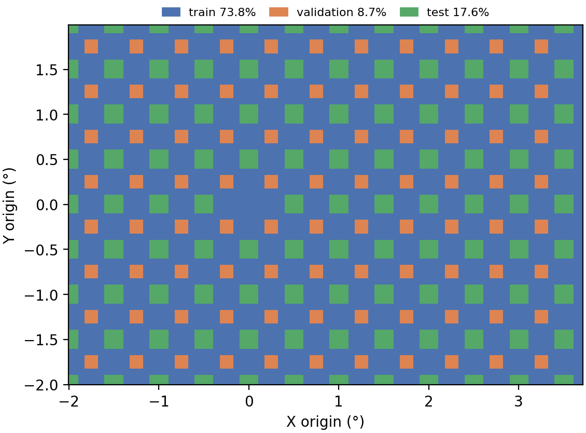

### Models

| model | run | params | weights | RAM peak / forward | best val MSE | selected epoch |
|---|---|---|---|---|---|---|
| 64 px ResNet | r64_occ15-40img-rot90-fill0-255_n00-20_e98_hold_3881600 | 11.17 M | 42.7 MB | 90 / 13 MB | 3.23e-5 | 98 |
| 128 px ResNet | r128_occ15-40img-rot90-fill0-255_n00-20_e98_hold_3881604 | 11.17 M | 42.7 MB | 90 / 18 MB | 2.08e-5 | 91 |
| 256 px ResNet | r256_occ15-40img-rot90-fill0-255_n00-20_e98_hold_3881612 | 11.17 M | 42.7 MB | 90 / 21 MB | 1.61e-5 | 91 |
| 512 px ResNet | r512_occ15-40img-rot90-fill0-255_n00-20_e98_hold_3881616 | 11.17 M | 42.7 MB | 96 / 44 MB | 2.18e-5 | 98 |
| 128 px MLP | mlp_r128_occ15-40img-rot90-fill0-255_n00-20_e98_hold_3881608 | 17.05 M | 65.1 MB | 134 / 3 MB | 5.42e-5 | 98 |

- **RAM:** CPU float32 inference at batch 1 with 4 threads, matching the Pi 4. The peak includes
  loading the checkpoint; the forward figure is the forward pass alone. Measured on x86, so only
  the increases carry over to the Pi.
- **Val MSE:** on normalized targets.

### Training recipe (identical for all five)

- **Data and selection:** trained on TRAIN, model selection on VALIDATION, one training seed.
- **Optimizer:** batch 512, AdamW with lr 2.8e-3 and weight decay 1e-3, cosine warm restarts with
  T_0 = 7, 98 epochs, fp16.
- **Photometric augmentation, per image:** brightness ×[0.6, 1.4], contrast ×[0.9, 1.1], Gaussian
  noise with σ drawn from [0, 0.2].
- **Occlusion augmentation, per image:** 2 boxes, each applied with p 0.5, edge 15–40% of the
  image, rotation ±90°, gray fill drawn from 0–255.
- **Hardware:** 64 px, 128 px and the MLP on L40S and H200 GPUs; 256 and 512 px on an H200 with
  `torch.compile`.

### Evaluation

All evaluations read frames from the 512 px image bank. Each perturbation is applied to the 512 px
frame, which is then box-averaged to the model's input size and rounded to 8 bit. Every model sees
the same boxes, factors and noise at the same start and step. Perturbed conditions run over 10
evaluation seeds, and ± is the standard deviation across them. Clean conditions are deterministic
and run once.

- **Closed-loop sweep:** the Algorithm 2 replay from all 2,320 starts on the 0.1° grid, under 43
  conditions. Stop at SSIM 0.97, at most 10 corrections.
- **Noise curve:** the closed-loop sweep at σ = 0–0.4.
- **Grid by area:** the training job's clean closed loop on the same 0.1° grid, run on the model's
  own bank and grouped by the split of each start position.

One example frame per condition, rendered through the same perturbation code, is in
[perturbation_examples/](perturbation_examples/).

## 2. Findings

1. **256 px is the most accurate model.**
   - Clean closed loop: 0.0076° from TRAIN starts and 0.0100° from TEST starts, the best of the
     five in every area.
   - Large occlusions: the highest success, 93.2% with 2 rotated gray 50% boxes and 91.7% with 2
     rotated bright 50% boxes.
   - `combined_harsh`: 99.8% success.
2. **128 px is the most noise-robust model.**
   - From σ = 0.25 up it has the lowest closed-loop error, 0.0262° at σ = 0.4 against 0.0315° for
     256 px.
   - Its clean error is higher than 256 px: 0.0136° against 0.0093°.
   - Box-averaging from 512 to 128 px leaves about half the per-pixel noise that 256 px keeps
     (section 4).
3. **256 vs 128 px, for your decision:**
   - 256 px wins on clean accuracy and large occlusions.
   - 128 px wins only under strong noise (σ ≥ 0.25), with the same 11.2 M parameters and slightly
     less forward-pass memory (18 vs 21 MB).
   - Both hold 100% success across the whole grid in every condition up to 30% boxes.
4. **512 px is no better than 256 px on clean frames and is worse under occlusion.**
   - Clean closed loop: 0.0142° from TRAIN starts, 0.0176° from TEST starts.
   - Large occlusions: 70.0% with 2 rotated gray 50% boxes, 67.2% with 2 rotated bright 50% boxes,
     and it is the first ResNet to fall off, already at 40% boxes (87.1%).
   - Under noise it degrades fastest past σ = 0.25, reaching 0.0383° at σ = 0.4.
5. **64 px is resolution-limited.**
   - Clean closed-loop error 0.0177°, and it is the only ResNet below 100% under brightness ×0.4
     (89.5%).
   - `combined_harsh` drops it to 85.0% success.
6. **The MLP is clearly behind.**
   - Clean closed-loop error about 2× the 128 px ResNet (0.0286° against 0.0136°).
   - Occlusion breaks it: 27.9% success with 2 rotated bright 50% boxes and 37.8% on
     `combined_harsh`.
   - Its train/eval gap under occlusion remains (section 7), which points to the architecture
     rather than the recipe.
7. **Held-out regions cost very little.**
   - Starting inside a held-out region costs about 0.002–0.003° of final error against starting in
     TRAIN, with 100% success in both.
   - The heatmaps in section 8 show no visible imprint of the TEST and VALIDATION regions.

## 3. Clean accuracy

### Grid closed loop by start area

Clean, 2,320 starts. Each cell is success; corrections; final error.

| model | TRAIN area (1,137) | VALIDATION regions (352) | TEST regions (831) |
|---|---|---|---|
| 64 px ResNet | 100%; 1.11; 0.0134° | 100%; 1.15; 0.0145° | 100%; 1.18; 0.0147° |
| 128 px ResNet | 100%; 1.05; 0.0114° | 100%; 1.05; 0.0135° | 100%; 1.08; 0.0136° |
| **256 px ResNet** | 100%; 1.02; **0.0076°** | 100%; 1.02; **0.0097°** | 100%; 1.05; **0.0100°** |
| 512 px ResNet | 100%; 1.02; 0.0142° | 100%; 1.02; 0.0169° | 100%; 1.05; 0.0176° |
| 128 px MLP | 100%; 1.19; 0.0231° | 100%; 1.24; 0.0256° | 100%; 1.28; 0.0250° |

The TEST column is the headline clean number: those starts sit in regions whose positions were
never trained on. The gap to the TRAIN column is 0.0013–0.0034° depending on the model.

## 4. Noise robustness

### Noise curve

Closed-loop final error (°), 2,320 starts, mean ± std over 10 evaluation seeds. σ = 0 is
deterministic. All runs reached 100% success.

| model | σ 0 | 0.05 | 0.10 | 0.15 | 0.20 | 0.25 | 0.30 | 0.40 |
|---|---|---|---|---|---|---|---|---|
| 64 px ResNet | 0.0177 | 0.0190 ± 0.0001 | 0.0223 ± 0.0002 | 0.0263 ± 0.0001 | 0.0321 ± 0.0001 | 0.0350 ± 0.0002 | 0.0334 ± 0.0003 | 0.0436 ± 0.0002 |
| 128 px ResNet | 0.0136 | 0.0140 ± 0.0001 | 0.0158 ± 0.0001 | 0.0181 ± 0.0001 | 0.0206 ± 0.0001 | **0.0225 ± 0.0003** | **0.0240 ± 0.0002** | **0.0262 ± 0.0002** |
| 256 px ResNet | **0.0093** | **0.0092 ± 0.0001** | **0.0117 ± 0.0001** | **0.0158 ± 0.0002** | 0.0211 ± 0.0002 | 0.0256 ± 0.0002 | 0.0280 ± 0.0002 | 0.0315 ± 0.0002 |
| 512 px ResNet | 0.0158 | 0.0146 ± 0.0001 | 0.0159 ± 0.0002 | 0.0175 ± 0.0002 | **0.0194 ± 0.0002** | 0.0227 ± 0.0003 | 0.0276 ± 0.0003 | 0.0383 ± 0.0002 |
| 128 px MLP | 0.0286 | 0.0259 ± 0.0001 | 0.0262 ± 0.0002 | 0.0266 ± 0.0002 | 0.0277 ± 0.0002 | 0.0298 ± 0.0002 | 0.0330 ± 0.0002 | 0.0411 ± 0.0004 |

The ordering flips with σ: 256 px is best up to σ = 0.15, 512 px at σ = 0.20, and 128 px from
σ = 0.25 on. 512 px degrades fastest at the top of the range, from best at σ = 0.20 to second
worst at σ = 0.4.

### Why lower resolutions filter noise

Noise is added to the 512 px frame, clipped at 0, rounded to 8 bit and then box-averaged.
Box-averaging by a factor k divides the remaining noise by about k:

| σ at 512 px | left at 512 px | 256 px | 128 px | 64 px |
|---|---|---|---|---|
| 0.10 | 0.071 | 0.037 | 0.022 | 0.015 |
| 0.20 | 0.132 | 0.068 | 0.038 | 0.026 |
| 0.30 | 0.191 | 0.098 | 0.054 | 0.034 |

- **Spot size:** about 9.4 px across at 512 px, 4.7 px at 256 px, 2.4 px at 128 px and 1.2 px at
  64 px.
- **Where the balance falls:** 64 px filters the most noise but loses spot position precision.
  128 px still resolves the spots with 4× less noise than 512 px. 256 px keeps more detail, which
  helps clean accuracy and hurts under strong noise.

## 5. Brightness and contrast

Closed-loop sweep, success / final error (°), 10 seeds. Success is 100% everywhere except 64 px at
brightness ×0.4. Training covered brightness ×0.6–1.4 and contrast ×0.9–1.1.

| condition | 64 px ResNet | 128 px ResNet | 256 px ResNet | 512 px ResNet | 128 px MLP |
|---|---|---|---|---|---|
| brightness ×0.4 | 89.5% / 0.034 | 100% / 0.021 | 100% / **0.020** | 100% / 0.026 | 100% / 0.035 |
| brightness ×0.6 | 100% / 0.022 | 100% / 0.015 | 100% / **0.011** | 100% / 0.018 | 100% / 0.029 |
| brightness ×1.4 | 100% / 0.019 | 100% / 0.014 | 100% / **0.010** | 100% / 0.018 | 100% / 0.032 |
| brightness ×1.6 | 100% / 0.022 | 100% / 0.016 | 100% / **0.012** | 100% / 0.021 | 100% / 0.036 |
| contrast ×0.9 | 100% / 0.018 | 100% / 0.013 | 100% / **0.009** | 100% / 0.017 | 100% / 0.028 |
| contrast ×1.1 | 100% / 0.018 | 100% / 0.014 | 100% / **0.009** | 100% / 0.016 | 100% / 0.028 |

Only brightness ×0.4 falls outside the training range on the dark side, and only 64 px loses
starts there.

## 6. Occlusion

Closed-loop sweep, success / final error (°), 10 seeds; success std is at most 1.4 points. Boxes
have fixed edges of 30–50% of the image, in black, bright or gray, rotated or not. The
`2_mixedfill` condition is the training occlusion itself with every box present.

| condition | 64 px ResNet | 128 px ResNet | 256 px ResNet | 512 px ResNet | 128 px MLP |
|---|---|---|---|---|---|
| 1 box, 15–40% | 100% / 0.022 | 100% / 0.018 | 100% / **0.014** | 99.9% / 0.023 | 92.7% / 0.046 |
| 2 boxes, 15–40% | 100% / 0.026 | 100% / 0.022 | 100% / **0.017** | 99.1% / 0.029 | 82.0% / 0.069 |
| 2 boxes 30% | 99.9% / 0.027 | 100% / 0.022 | 100% / **0.018** | 99.1% / 0.030 | 78.5% / 0.076 |
| 2 gray boxes 30% | 99.8% / 0.028 | 100% / 0.022 | 100% / **0.018** | 99.5% / 0.028 | 84.5% / 0.061 |
| 2 rotated gray boxes 30% | 99.8% / 0.027 | 100% / 0.022 | 100% / **0.017** | 99.7% / 0.027 | 84.6% / 0.060 |
| 2 rotated bright boxes 30% | 99.7% / 0.030 | 100% / 0.023 | 100% / **0.018** | 99.5% / 0.027 | 64.1% / 0.098 |
| 2 boxes 40% | 99.0% / 0.033 | 99.0% / 0.029 | 99.0% / **0.025** | 87.1% / 0.059 | 57.8% / 0.153 |
| 2 boxes 50% | 92.4% / 0.057 | **93.5%** / **0.044** | 90.0% / 0.053 | 50.7% / 0.199 | 34.7% / 0.359 |
| 2 rotated gray boxes 50% | 84.2% / 0.073 | 90.2% / 0.047 | **93.2%** / **0.042** | 70.0% / 0.113 | 48.6% / 0.234 |
| 2 rotated bright boxes 50% | 74.5% / 0.107 | 82.1% / 0.064 | **91.7%** / **0.046** | 67.2% / 0.122 | 27.9% / 0.466 |
| training occlusion (`2_mixedfill`) | 99.9% / 0.026 | 100% / 0.021 | 100% / **0.016** | 99.7% / 0.025 | 86.8% / 0.057 |
| combined (training augmentation) | 99.6% / 0.035 | 100% / 0.024 | 100% / **0.020** | 99.6% / 0.029 | 75.7% / 0.089 |
| combined_harsh | 85.0% / 0.100 | 99.7% / 0.035 | **99.8%** / **0.033** | 99.0% / 0.037 | 37.8% / 0.373 |

- **Up to 30% boxes, any fill:** every ResNet stays at ≥ 99% success.
- **40–50% boxes:** 256 px is the most robust, with 128 px close behind except on plain 50% boxes,
  where 128 px is marginally ahead (93.5% vs 90.0%). 512 px falls off sharply at 40% (87.1%) and
  50% (50.7–70.0%).
- **MLP:** it fails from 30% boxes onward.
- **Full table:** all 43 conditions are in [data/sweep_v2.md](data/sweep_v2.md).

## 7. The occlusion recipe bug and its fix

1. **Old recipe.** An earlier recipe drew one set of occlusion boxes per batch and shared it across
   all 512 images, filled black or white.
2. **What went wrong.** In BatchNorm training mode, batch statistics absorb part of a box shared by
   every image. At inference BatchNorm uses running statistics, so the absorbed part came back.
3. **Why it went unnoticed.** Validation runs on clean frames and did not catch it.
4. **Size of the damage.** Under bright boxes the eval-mode loss was 76× (512 px ResNet) and 550×
   (MLP) their train-mode loss.
5. **MLP mechanism.** A Linear layer followed by BatchNorm subtracts exactly any component that is
   constant across the batch, so a shared box disappears from its input.
6. **ResNet mechanism, not settled.** The cancelled share per layer was about the same at every
   resolution (≈ 0.4 in the first two BatchNorm layers). Why 512 px depended on it more is not
   settled; the probe is in `/home/evv/data/bn_probe/`.
7. **The fix.** Boxes are drawn per image with a gray fill uniform in 0–255.
8. **Check after the fix.** Normalized MSE under gray boxes on TRAIN images, BatchNorm in train
   mode vs eval mode:

| model | train mode | eval mode |
|---|---|---|
| 64 px ResNet | 3.8e-4 | 1.3e-4 |
| 128 px ResNet | 4.0e-4 | 1.1e-4 |
| 256 px ResNet | 1.0e-4 | 7.4e-5 |
| 512 px ResNet | 5.6e-4 | 1.5e-4 |
| 128 px MLP | 5.2e-4 | 1.4e-3 |

Eval mode is now no worse than train mode for every ResNet. The MLP still loses under occlusion in
eval mode, by 2.7× instead of 550×.

## 8. Figures per model

- **Heatmaps:** the clean grid closed loop over all 2,320 starts, with TEST regions outlined in
  green and VALIDATION regions in orange. Neither region shows up as a worse area.
- **Noise curve:** closed-loop final error vs σ with success rate, over 10 evaluation seeds.

### 64 px ResNet

| corrections | final error | noise curve |
|---|---|---|
| 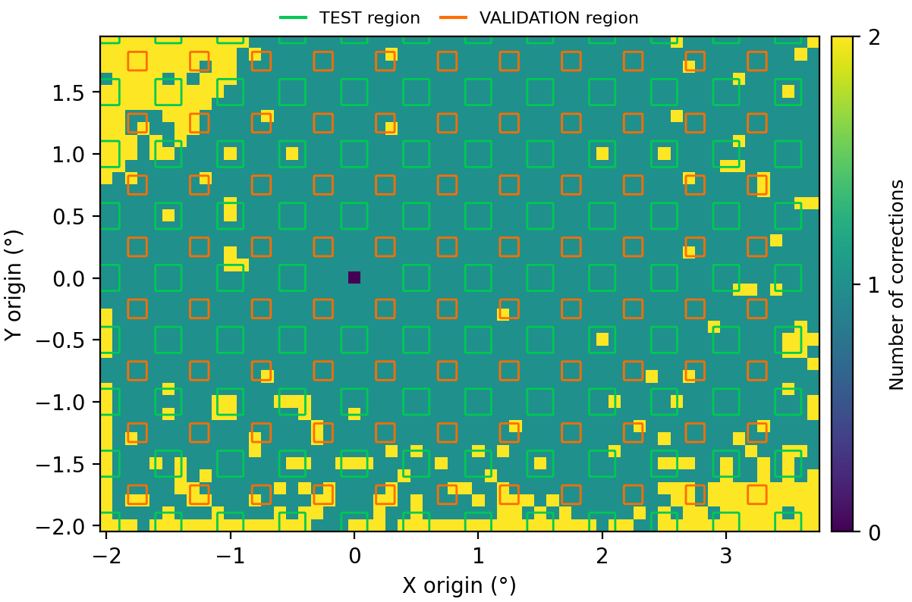 | 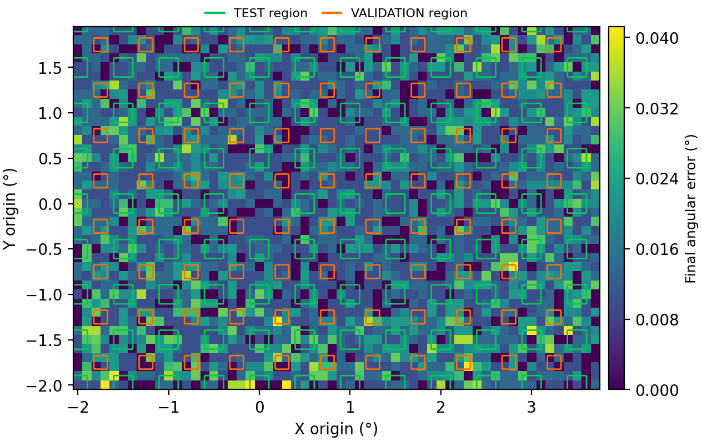 | 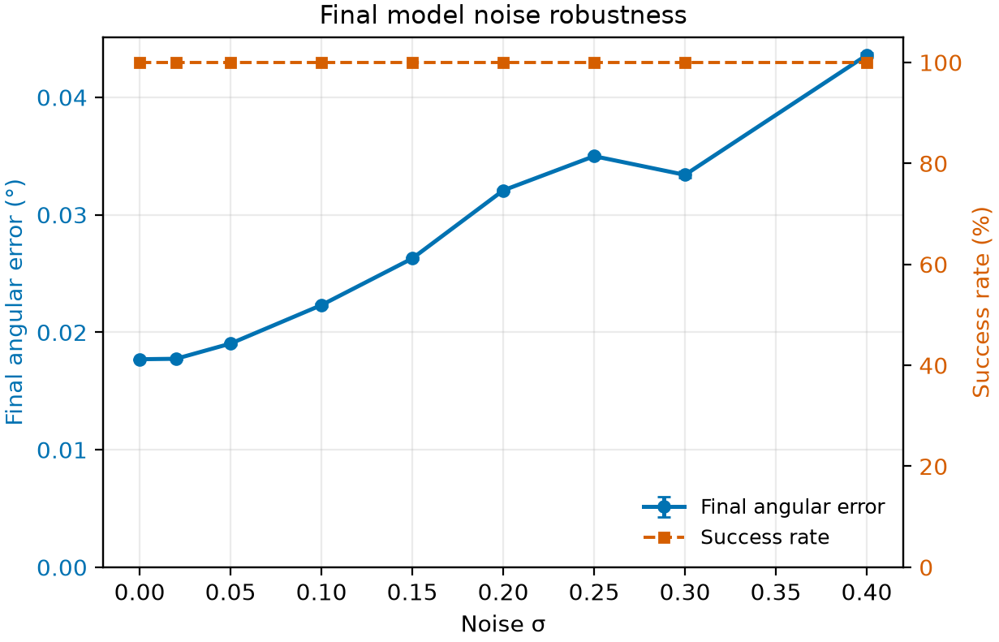 |

### 128 px ResNet

| corrections | final error | noise curve |
|---|---|---|
| 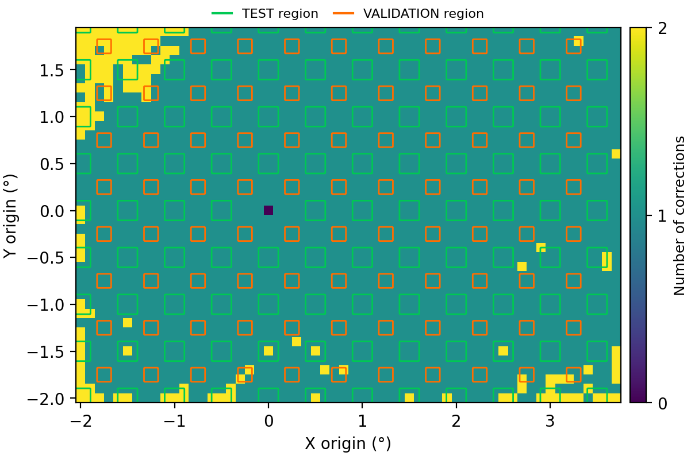 | 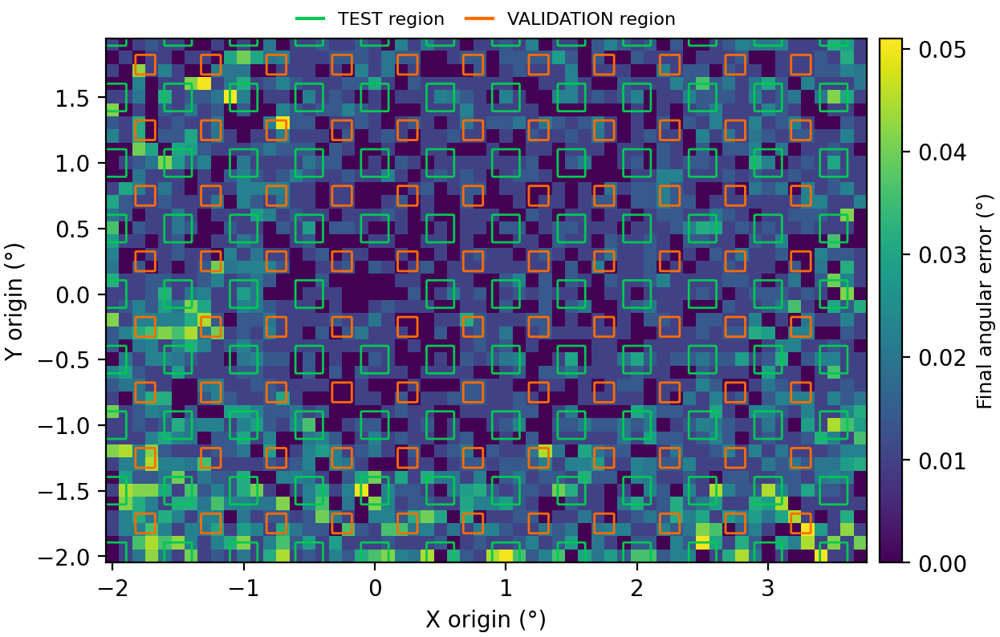 | 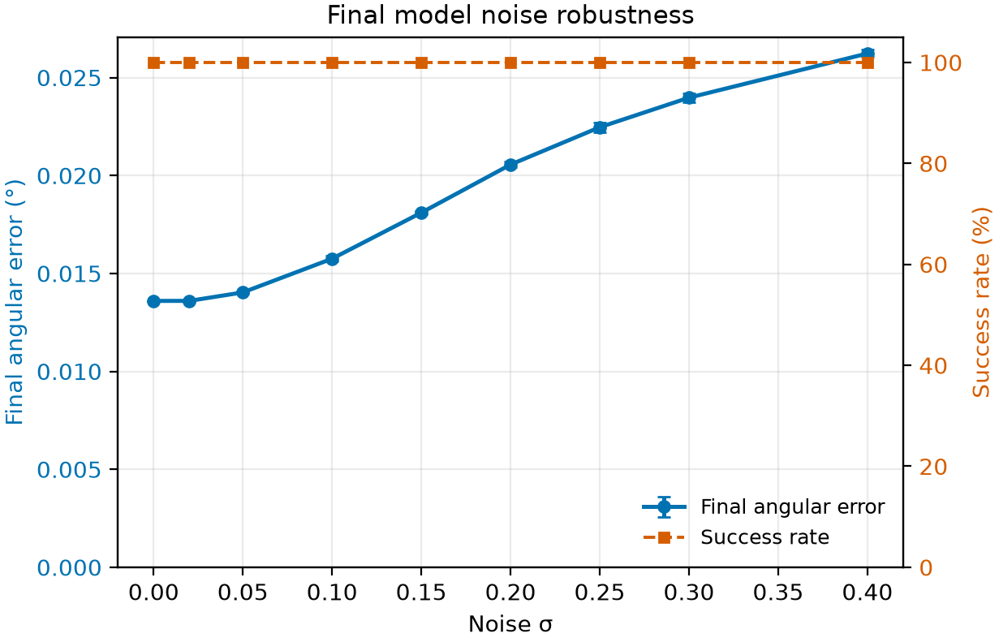 |

### 256 px ResNet

| corrections | final error | noise curve |
|---|---|---|
| 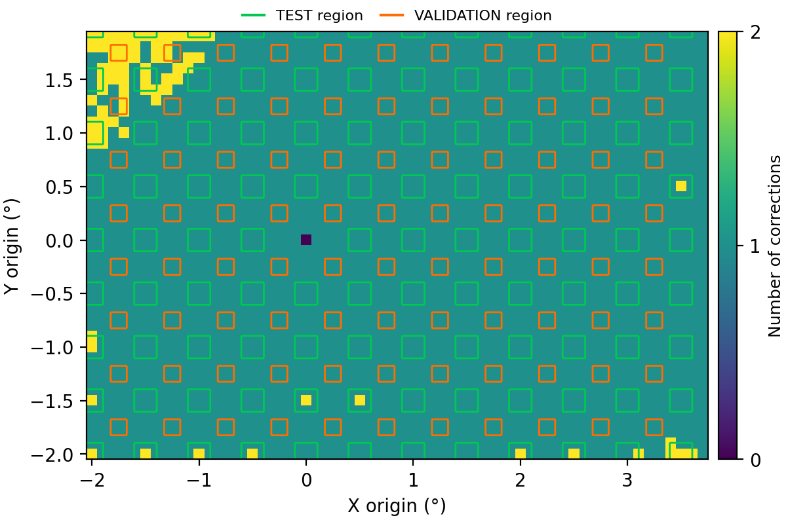 | 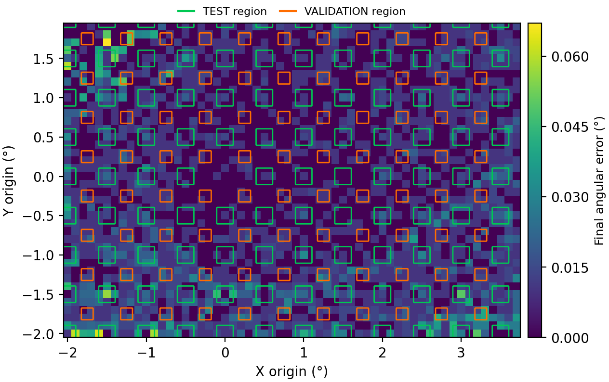 | 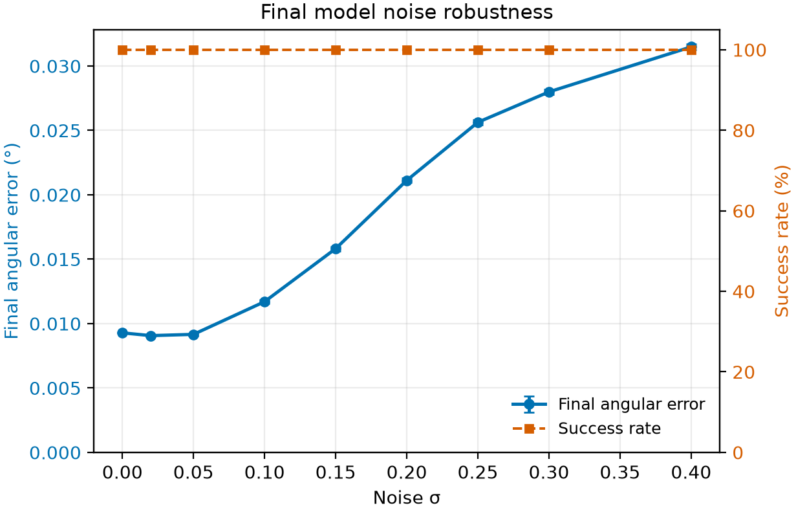 |

### 512 px ResNet

| corrections | final error | noise curve |
|---|---|---|
| 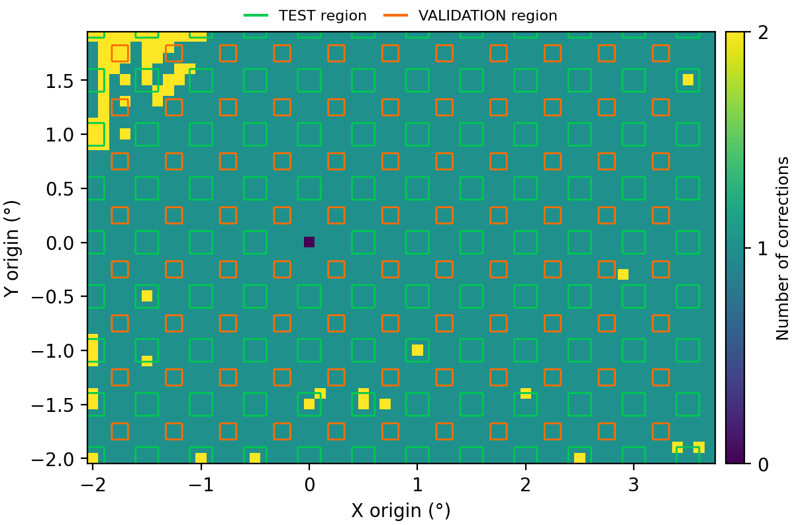 | 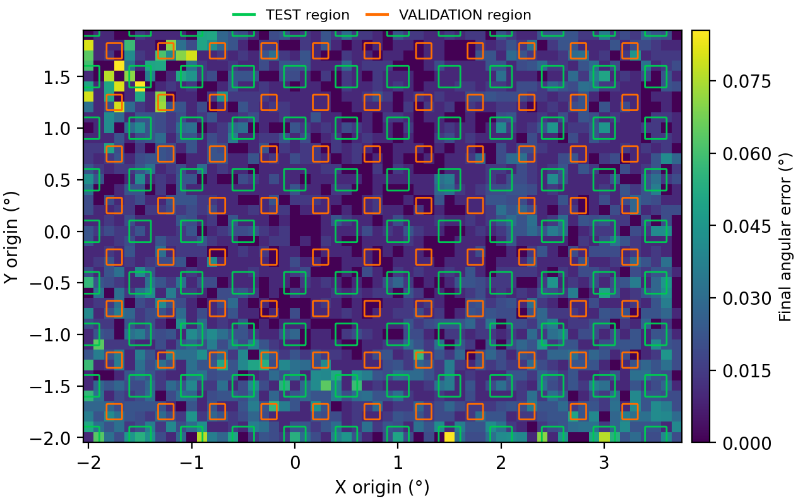 | 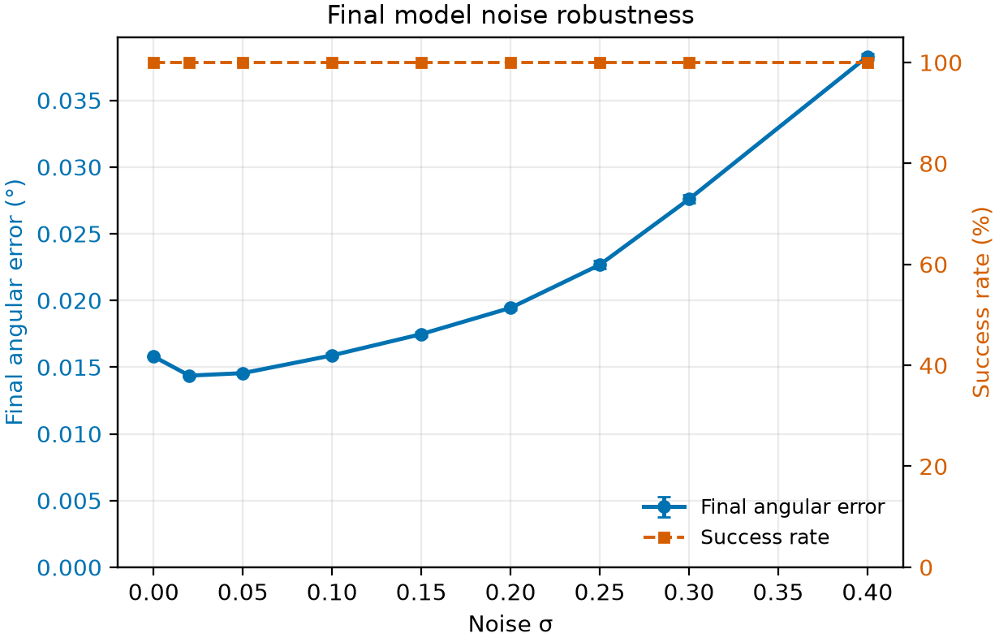 |

### 128 px MLP

| corrections | final error | noise curve |
|---|---|---|
| 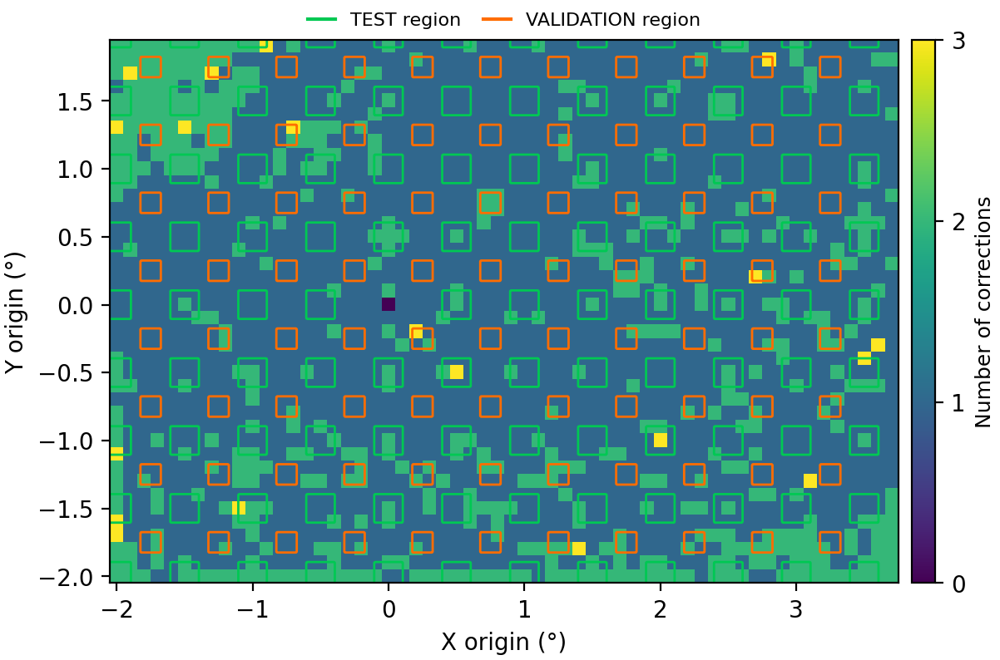 | 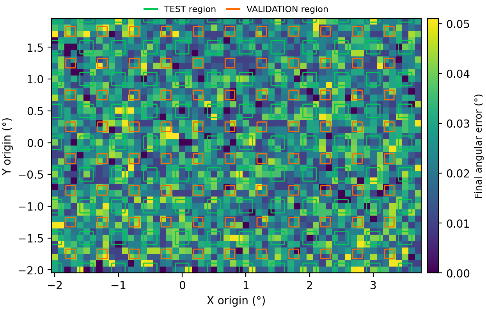 | 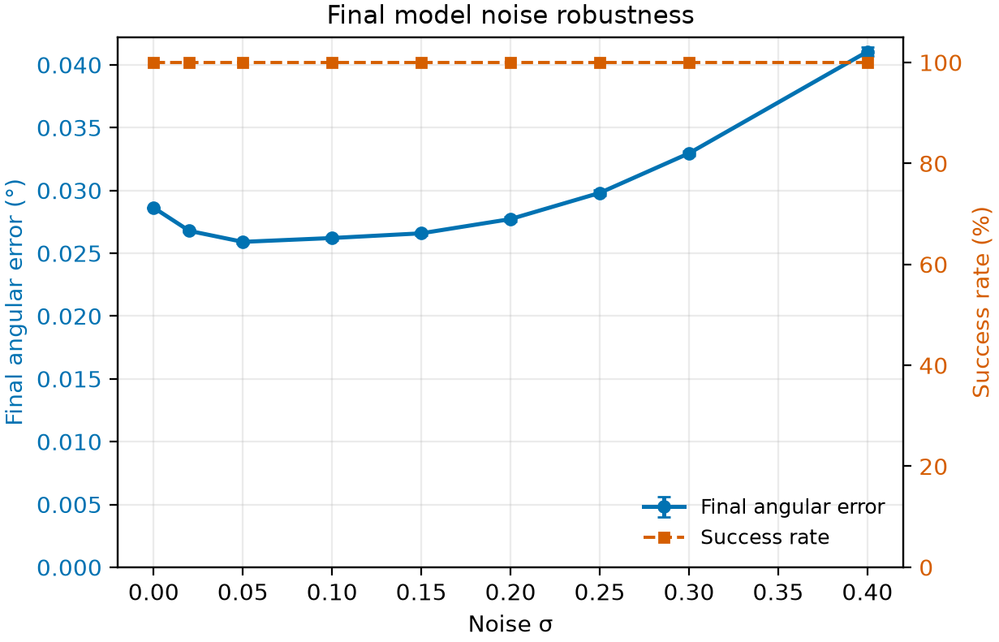 |

## 9. Caveats

- **One training seed per model.** Evaluation seeds are averaged 10 times, but each model was
  trained once. On the random split, a second training seed changed clean and noise results by at
  most 0.002° and the hardest occlusion conditions by tens of points, so treat differences of that
  size between models as unconfirmed.
- **Evaluation-seed spread is small.** Across 10 seeds it is at most 1.4 points of success rate and
  0.0004° of error, so the model differences above are not evaluation noise.
- **Offline only.** These are replays on the image bank, not hardware runs, so time to align is not
  measured.
- **Limited distance from TRAIN.** TEST regions lie 0.01–0.11° from TRAIN positions, and all images
  come from one capture session.
- **Idealized noise.** i.i.d. Gaussian noise at 512 px. Camera noise is partly smoothed by the 7×7
  blur in preprocessing, so the advantage of lower resolutions may be smaller on hardware.
- **Different frames for the grid-by-area table.** It uses each model's own-resolution bank (JPEG
  q95 re-encoded at 64/128/256 px); every other evaluation uses box-averaged 512 px frames.
- **Different GPUs.** 256 and 512 px trained on an H200 with `torch.compile`, the others without
  it on H200 and L40S GPUs. This does not change the math of the recipe.

## 10. Reproducing

| Step | Command or file |
|---|---|
| Split | `holdout/make_split.py` |
| Training and grid eval | `RES=<res> [TRAIN_EXTRA="--arch mlp"] bash holdout/submit_64.sh`; the training job replays the clean 0.1° grid itself |
| Noise curves | `cluster/noise_curve_l40s.slurm` (`SEEDS=` for the seed list) |
| Sweeps | `cluster/eval_sweep_l40s.slurm` (`EXTRA_ARGS="--perturb-seeds ..."`) |
| Merging seed batches | `/home/evv/data/merge_seeds.py --base eval_results/<run>` combines two runs' per-seed CSVs into `_sweep10`, `_noise_curve10`, `_holdout_test10` |
| Heatmaps | `holdout/heatmaps.py` |
| Perturbation examples | `utils/perturbation_examples.py` |
| Per-model summary | `holdout/report.py` (models table and the grid-by-area table) |
| Model table | `utils/model_table.py --manifest reports/data/model_table_manifest.json` |
| Source tables | `reports/data/` (`tables_v2.md`, `sweep_v2.md`, `model_table.md`) |
