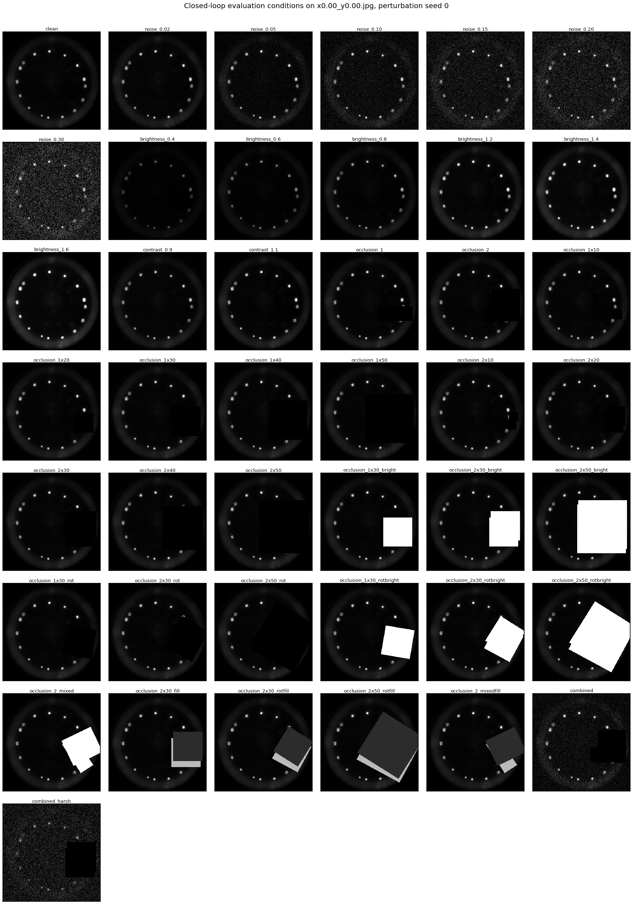

# Perturbation examples

Every condition of the closed-loop sweep (`utils/eval_sweep.CONDITIONS`) applied to `x0.00_y0.00.jpg`
from the 512 px bank at perturbation seed 0, trajectory 0, step 0, through the same
`utils.eval_batched.Perturbation` the evaluations use. Frames are shown at 512 px, before the
box average to a model's input resolution.

Regenerate with `python utils/perturbation_examples.py`.

| condition | what it draws |
|---|---|
| `clean` | none |
| `noise_0.02` | noise sigma 0.02, re-drawn per step; seed 0; SSIM on clean image |
| `noise_0.05` | noise sigma 0.05, re-drawn per step; seed 0; SSIM on clean image |
| `noise_0.10` | noise sigma 0.1, re-drawn per step; seed 0; SSIM on clean image |
| `noise_0.15` | noise sigma 0.15, re-drawn per step; seed 0; SSIM on clean image |
| `noise_0.20` | noise sigma 0.2, re-drawn per step; seed 0; SSIM on clean image |
| `noise_0.30` | noise sigma 0.3, re-drawn per step; seed 0; SSIM on clean image |
| `brightness_0.4` | brightness factor 0.4; seed 0; SSIM on clean image |
| `brightness_0.6` | brightness factor 0.6; seed 0; SSIM on clean image |
| `brightness_0.8` | brightness factor 0.8; seed 0; SSIM on clean image |
| `brightness_1.2` | brightness factor 1.2; seed 0; SSIM on clean image |
| `brightness_1.4` | brightness factor 1.4; seed 0; SSIM on clean image |
| `brightness_1.6` | brightness factor 1.6; seed 0; SSIM on clean image |
| `contrast_0.9` | contrast factor 0.9; seed 0; SSIM on clean image |
| `contrast_1.1` | contrast factor 1.1; seed 0; SSIM on clean image |
| `occlusion_1` | 1 occlusion box(es) of edge [0.15, 0.4] with prob 1 per trajectory; seed 0; SSIM on clean image |
| `occlusion_2` | 2 occlusion box(es) of edge [0.15, 0.4] with prob 1 per trajectory; seed 0; SSIM on clean image |
| `occlusion_1x10` | 1 occlusion box(es) of edge [0.1, 0.1] with prob 1 per trajectory; seed 0; SSIM on clean image |
| `occlusion_1x20` | 1 occlusion box(es) of edge [0.2, 0.2] with prob 1 per trajectory; seed 0; SSIM on clean image |
| `occlusion_1x30` | 1 occlusion box(es) of edge [0.3, 0.3] with prob 1 per trajectory; seed 0; SSIM on clean image |
| `occlusion_1x40` | 1 occlusion box(es) of edge [0.4, 0.4] with prob 1 per trajectory; seed 0; SSIM on clean image |
| `occlusion_1x50` | 1 occlusion box(es) of edge [0.5, 0.5] with prob 1 per trajectory; seed 0; SSIM on clean image |
| `occlusion_2x10` | 2 occlusion box(es) of edge [0.1, 0.1] with prob 1 per trajectory; seed 0; SSIM on clean image |
| `occlusion_2x20` | 2 occlusion box(es) of edge [0.2, 0.2] with prob 1 per trajectory; seed 0; SSIM on clean image |
| `occlusion_2x30` | 2 occlusion box(es) of edge [0.3, 0.3] with prob 1 per trajectory; seed 0; SSIM on clean image |
| `occlusion_2x40` | 2 occlusion box(es) of edge [0.4, 0.4] with prob 1 per trajectory; seed 0; SSIM on clean image |
| `occlusion_2x50` | 2 occlusion box(es) of edge [0.5, 0.5] with prob 1 per trajectory; seed 0; SSIM on clean image |
| `occlusion_1x30_bright` | 1 occlusion box(es) of edge [0.3, 0.3] with prob 1 per trajectory, bright (1) with prob 1; seed 0; SSIM on clean image |
| `occlusion_2x30_bright` | 2 occlusion box(es) of edge [0.3, 0.3] with prob 1 per trajectory, bright (1) with prob 1; seed 0; SSIM on clean image |
| `occlusion_2x50_bright` | 2 occlusion box(es) of edge [0.5, 0.5] with prob 1 per trajectory, bright (1) with prob 1; seed 0; SSIM on clean image |
| `occlusion_1x30_rot` | 1 occlusion box(es) of edge [0.3, 0.3] with prob 1 per trajectory, rotated in [-45, 45] deg; seed 0; SSIM on clean image |
| `occlusion_2x30_rot` | 2 occlusion box(es) of edge [0.3, 0.3] with prob 1 per trajectory, rotated in [-45, 45] deg; seed 0; SSIM on clean image |
| `occlusion_2x50_rot` | 2 occlusion box(es) of edge [0.5, 0.5] with prob 1 per trajectory, rotated in [-45, 45] deg; seed 0; SSIM on clean image |
| `occlusion_1x30_rotbright` | 1 occlusion box(es) of edge [0.3, 0.3] with prob 1 per trajectory, rotated in [-45, 45] deg, bright (1) with prob 1; seed 0; SSIM on clean image |
| `occlusion_2x30_rotbright` | 2 occlusion box(es) of edge [0.3, 0.3] with prob 1 per trajectory, rotated in [-45, 45] deg, bright (1) with prob 1; seed 0; SSIM on clean image |
| `occlusion_2x50_rotbright` | 2 occlusion box(es) of edge [0.5, 0.5] with prob 1 per trajectory, rotated in [-45, 45] deg, bright (1) with prob 1; seed 0; SSIM on clean image |
| `occlusion_2_mixed` | 2 occlusion box(es) of edge [0.15, 0.4] with prob 1 per trajectory, rotated in [-90, 90] deg, bright (1) with prob 0.5; seed 0; SSIM on clean image |
| `occlusion_2x30_fill` | 2 occlusion box(es) of edge [0.3, 0.3] with prob 1 per trajectory, gray fill uniform in [0, 1]; seed 0; SSIM on clean image |
| `occlusion_2x30_rotfill` | 2 occlusion box(es) of edge [0.3, 0.3] with prob 1 per trajectory, rotated in [-45, 45] deg, gray fill uniform in [0, 1]; seed 0; SSIM on clean image |
| `occlusion_2x50_rotfill` | 2 occlusion box(es) of edge [0.5, 0.5] with prob 1 per trajectory, rotated in [-45, 45] deg, gray fill uniform in [0, 1]; seed 0; SSIM on clean image |
| `occlusion_2_mixedfill` | 2 occlusion box(es) of edge [0.15, 0.4] with prob 1 per trajectory, rotated in [-90, 90] deg, gray fill uniform in [0, 1]; seed 0; SSIM on clean image |
| `combined` | brightness factor in [0.6, 1.4] per trajectory; contrast factor in [0.9, 1.1] per trajectory; noise sigma 0.1, re-drawn per step; 2 occlusion box(es) of edge [0.15, 0.4] with prob 1 per trajectory; seed 0; SSIM on clean image |
| `combined_harsh` | brightness factor 0.6; noise sigma 0.2, re-drawn per step; 2 occlusion box(es) of edge [0.3, 0.3] with prob 1 per trajectory; seed 0; SSIM on clean image |
