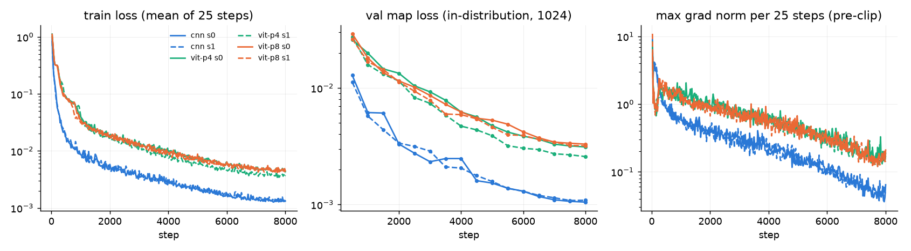
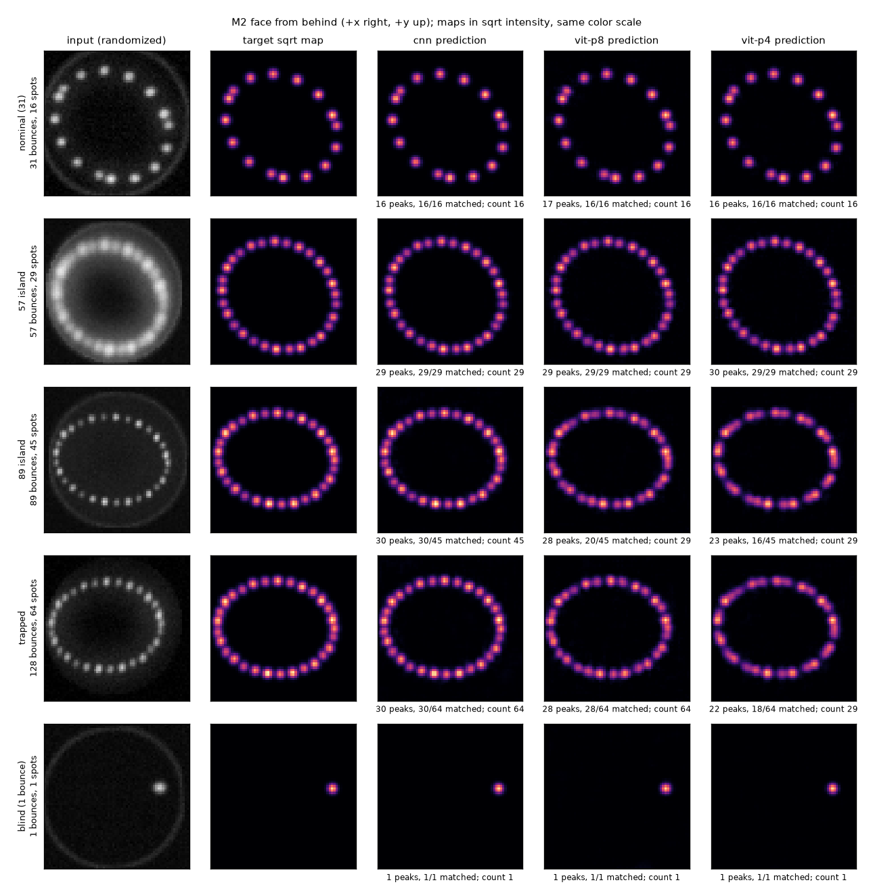

# Single-frame encoder benchmark (PLAN phase 5, Level 1)

CNN vs ViT frame encoders trained on single-image targets with randomized renders.
Supervised only, local GPU (RTX A2000 12 GB, shared with another job during most of the
runs). Code: `render_random.py`, `targets.py`, `frame_data.py`, `encoders.py`,
`pretrain_encoder.py`, `eval_encoder.py`, `tests/test_encoder.py`. Full tables:
[encoder_tables.md](encoder_tables.md) (generated by `eval_encoder.py`).

## Setup

**Data** (`frame_data.py`), new every batch of 256:

- M2 tilt: 50 % uniform in the +-2 deg box, 50 % uniform over the 69 240 cells of a
  0.01 deg nominal-geometry scan with >= 4 bounces (uniform inside the cell);
- physical jitter per sample: separation +-0.5 mm, laser pitch / yaw +-0.05 deg, laser
  dx / dy and M2 tx / ty +-0.05 mm (the targets see it);
- render: `RandomRenderer` (below), targets: `TargetBuilder` (below).

Batch generation (sim + targets + randomized render) takes ~15-20 ms; the sim is < 1 ms.

**Nuisances** (`render_random.py`, input image only, per sample):

| group | parameter | training range | held out (OOD) |
|---|---|---|---|
| surface | blur sigma (geometric mean of the axes) | 0.3-1.0 mm | 1.2-1.4 mm |
| | spot aspect (major / minor sigma), orientation | 1.0-1.3, 0-180 deg | |
| | scatter halo sigma, peak / spot peak | 2-4 mm, 0-0.1 | |
| camera | gain (log-uniform; also laser color) | x0.6-1.5 | x0.4, x1.8 |
| | gamma | 0.8-1.2 | |
| | black level | 0-0.05 | |
| | read noise std | 0-0.02 | 0.04 |
| | shot noise variance per unit signal | 0-0.001 | |
| pose | rotation | +-5 deg | +-(7-9) deg |
| | shift | +-0.5 mm per axis | |
| | scale (log-uniform) | 0.95-1.05 | |
| | perspective: corner displacement | up to 3 % of the field per axis | |
| mirror frame | rim brightness (ring at the aperture edge) | 0-0.15 | |
| | mirror-face glow | 0-0.05 | |

Brightness values are full-scale fractions at unit gain. Order: elliptical spots + halo
on the canonical grid (exact Gaussians, `torch.compile`d), aperture, rim and glow,
pose warp (`grid_sample`, bilinear), gain, response `1 - exp(-1.6 I)`, gamma, black
level, noise, uint8. Without parameters the renderer returns `SpotRenderer`'s image
(bit-identical, tested).

**Evaluation sets** (fixed seeds): 8192 states from the training distribution, rendered
three ways - *clean* (`SpotRenderer`, no nuisances), *in-distribution* (training
ranges), *OOD* (training ranges with one held-out factor per sample, uniform over the
five); plus a balanced *89 vs trapped* set (1024 each: tilts from the nominal 89 /
trapped cells plus the physical jitter, kept where the jittered sim gives 89 bounces or
the cap).

**Targets** (`targets.py`, canonical M2 frame): spot map (64 x 64, Gaussian of 1 px per
M2 spot, peak 0.98^k, summed), count (0-64, classification), ellipse (direct
least-squares conic fit, Halir-Flusser form, as centre + shape tensor
`R diag(a, b) R^T`, so there is no angle wrap and no discontinuity at a = b; masked
below 5 spots). Probe labels only: true M2 tilt, bounces, path, region.

**Models** (`encoders.py`), z = 256, all heads read z only:

| | encoder | params |
|---|---|---|
| CNN | stem conv 32 @ 64 x 64; stages 64 @ 32, 128 @ 16, 160 @ 8 (1 / 1 / 2 pre-activation GN residual blocks, stride-2 conv between); 64 spatial-softmax keypoints (x, y) + mean and max pooled features -> MLP (384) -> z | 1.85 M |
| ViT-p8 | 8 x 8 patches (64 tokens), width 160, 6 pre-LN blocks, 4 heads, MLP ratio 2, fixed 2D sin-cos positions, 4-query attention pooling -> z | 1.52 M |
| ViT-p4 | same with 4 x 4 patches (256 tokens) | 1.51 M |
| heads | map: linear to 64 @ 8 x 8, two upsampling stages (nearest x2, coordinate channels, 2 x conv3x3 + GN) to 32 @ 32 x 32, conv to 4 channels + pixel shuffle to 64 x 64; count: MLP -> 65; ellipse: MLP -> 5 | 1.31 M |

**Loss:** `L_map + 0.1 CE_count + L_ell`. `L_map` = peak-weighted MSE on the square
root of the spot map, `mean((1 + 20 sqrt(t)) (p - sqrt(t))^2)`. Why not the CenterNet
focal loss: the target peaks carry the incident intensity (1 down to 0.08) and
overlapping spots sum, while the focal loss treats the map as a probability with unit
peaks and cannot regress either. The square root compresses the 13x brightness range
so the dim late spots count, and the peak weight counters the sparsity that pulls a
plain MSE toward an empty map. `L_ell` = smooth L1 (beta 0.2 mm) on the ellipse vector /
10 mm, valid fits only.

**Training** (`pretrain_encoder.py`): AdamW (betas 0.9 / 0.95, weight decay 0.05, none
on norms, biases, queries), peak LR 1e-3 (CNN) / 5e-4 (ViT), 300 warmup steps, cosine to
1 %, grad clip 1.0, bf16 autocast, `torch.compile`, batch 256, 8000 steps (2.05 M
frames, all new) per run.

## Results

Two seeds per model, mean +- std over the seeds (std 0.000 = below 0.0005). Eval sets
n = 8192; detection = local maxima of the predicted sqrt map above 0.15, Hungarian
matching to the true M2 centres, match radius 0.5 mm.

**Detector ceiling.** The same detector on the *target* map finds 93.7 % of the true
spots (precision 1.000, 0.010 mm): overlapping spots merge. In the 89 and trapped
patterns, 45 and 64 spots sit on about 29 resolvable positions (ceiling recall 0.644
and 0.453), the same positions in both, which is why they "look identical".

**In-distribution**

| model | precision | recall | loc err (mm) | count exact | ellipse centre (mm) | semi-axes a / b MAE (mm) | angle (deg) |
|---|---|---|---|---|---|---|---|
| CNN | 0.980 | **0.930** | **0.066 +- 0.001** | 1.000 | **0.036** | **0.025 / 0.023** | **0.34** |
| ViT-p8 | 0.973 | 0.916 | 0.115 +- 0.001 | 0.999 | 0.062 | 0.050 / 0.051 | 0.51 |
| ViT-p4 | 0.975 | 0.916 | 0.109 +- 0.006 | 0.999 | 0.056 | 0.046 / 0.047 | 0.49 |

**Clean** (`SpotRenderer`, no nuisances)

| model | precision | recall | loc err (mm) | count exact | ellipse centre (mm) | semi-axes a / b MAE (mm) | angle (deg) |
|---|---|---|---|---|---|---|---|
| CNN | 0.978 | 0.929 | 0.139 +- 0.013 | 1.000 | 0.085 | 0.069 / 0.066 | 0.52 |
| ViT-p8 | 0.963 | 0.907 | 0.139 +- 0.005 | 0.999 | 0.088 | 0.055 / 0.092 | 0.62 |
| ViT-p4 | 0.955 | 0.907 | 0.141 +- 0.008 | 0.998 | 0.089 | 0.061 / 0.086 | 0.60 |

**OOD** (one held-out factor per sample)

| model | precision | recall | loc err (mm) | count exact | ellipse centre (mm) | semi-axes a / b MAE (mm) | angle (deg) |
|---|---|---|---|---|---|---|---|
| CNN | 0.970 | **0.927** | **0.087 +- 0.001** | **0.989 +- 0.002** | **0.045** | **0.033 / 0.032** | **0.44** |
| ViT-p8 | 0.944 | 0.899 | 0.139 +- 0.002 | 0.975 +- 0.001 | 0.077 | 0.053 / 0.064 | 0.63 |
| ViT-p4 | 0.943 | 0.898 | 0.133 +- 0.005 | 0.970 +- 0.002 | 0.070 | 0.050 / 0.059 | 0.61 |

Count within +-1 equals the exact count to 0.001 everywhere (the counts are discrete
with large gaps: 1, 2, 5, 8, 9, ..., 29, 45, 64).

**OOD by held-out factor** (recall / count exact): the held-out blur (sigma 1.2-1.4 mm)
is the only factor that hurts. CNN 0.916 / 0.944, ViT-p8 0.870 / 0.885, ViT-p4
0.855 / 0.863. Rotation 7-9 deg, read noise 0.04 and gain x0.4 / x1.8 cost < 0.01
recall and < 0.003 count accuracy for every model.

**89 vs trapped** (balanced probe set, 1024 each; precision / recall / count exact)

| model | set | 89 | trapped |
|---|---|---|---|
| CNN | in-dist | 0.984 / 0.649 / **0.995** | 0.995 / 0.462 / **0.957** |
| CNN | OOD | 0.983 / 0.647 / 0.831 | 0.995 / 0.462 / 0.839 |
| ViT-p8 | in-dist | 0.869 / 0.521 / 0.492 | 0.990 / 0.452 / 0.304 |
| ViT-p4 | in-dist | 0.938 / 0.590 / 0.310 | 0.987 / 0.452 / 0.220 |

The CNN reaches the detector ceiling and counts both patterns from the summed
intensities; both ViTs mostly answer 29 (the 57 pattern) for 89 and trapped frames
(figure). In training, 89 frames are 0.15 % and trapped frames 0.05 % of all frames
(65k-frame count, after the jitter).

**Linear probes on frozen z** (ridge / logistic, fit on one half, reported on the
other; tilt on frames with >= 3 bounces)

| features | set | tilt R^2 | tilt RMSE (deg) | bounces R^2 | bounces MAE | 89 vs trapped acc |
|---|---|---|---|---|---|---|
| CNN z | in-dist | **0.997** | **0.043** | **0.992** | **1.16** | **1.000** |
| CNN z | OOD | 0.996 | 0.050 | 0.982 | 1.59 | 0.993 |
| ViT-p8 z | in-dist | 0.988 | 0.088 | 0.971 | 2.21 | 0.968 |
| ViT-p4 z | in-dist | 0.991 | 0.077 | 0.976 | 1.82 | 0.940 |
| pixels 32 x 32 | clean | 0.998 | 0.037 | 0.999 | 0.34 | 1.000 |
| pixels 32 x 32 | in-dist | 0.854 | 0.319 | 0.770 | 7.00 | 0.933 |
| pixels 32 x 32 | OOD | 0.794 | 0.379 | 0.700 | 8.09 | 0.855 |

The M2 tilt is linearly readable from one frame wherever the beam reaches M1 again
(>= 3 bounces): 0.043 deg RMSE for the CNN z, robust to the nuisances that break the
raw-pixel probe. 89 vs trapped is linearly separable in the CNN z (raw pixels: 0.933).

**Clean is not the easy set.** Localization on clean frames (0.14 mm) is worse than
in-distribution (0.066 mm for the CNN). A follow-up on 2048 states (seed-0 models,
loc err in mm, CNN / ViT-p8):

| condition | CNN | ViT-p8 |
|---|---|---|
| in-distribution | 0.066 | 0.117 |
| rim = glow = 0 | 0.109 | 0.158 |
| no pose change | 0.063 | 0.104 |
| no pose change, rim = glow = 0 | 0.092 | 0.140 |
| identity parameters (randomized path) | 0.151 | 0.145 |
| clean (`SpotRenderer`) | 0.153 | 0.145 |

The pose randomization itself costs almost nothing; the encoders anchor the mirror
frame on the rim and the face glow, and lose ~0.04 mm without them. Clean frames have
no frame cue, no noise and no halo, a corner of the training distribution. The randomized
path with identity parameters matches `SpotRenderer` here, so this is not a renderer
mismatch. For deployment: the real image must show the mirror edge, or the camera pose
must be fixed and the pose randomization narrowed.

## Training stability and cost

- No divergence and no non-finite step in any of the six runs. Clipping at 1.0 was
  active only early: windows with a mean pre-clip norm > 1 cover the first ~275 steps
  (CNN) and up to ~600 steps (ViT). Max pre-clip norm after step 1000: CNN 0.64, ViT-p8
  1.3-1.4, ViT-p4 1.6-2.1; after step 4000: 0.26 / 0.67-0.68 / 0.70-0.80.
- Seed spread is small: final validation loss CNN 1.35 / 1.37e-3, ViT-p8 4.66 /
  4.49e-3, ViT-p4 5.12 / 3.74e-3 (the largest spread); eval metrics differ by <= 0.006
  between seeds.
- The CNN's validation map loss is 2-3x below the ViTs' at every checkpoint. All six
  runs were still improving when the cosine schedule ended (val map loss -15 to -21 %
  from step 6000 to 8000), and the ViT / CNN ratio grew from ~2.5x at step 4000 to
  ~2.8x at 8000, so the gap is not closing within this budget.
- Wall time per 8000-step run (data generation included, GPU shared with another job
  for most runs): CNN 13.9 +- 0.5 min, ViT-p8 8.9 +- 0.5, ViT-p4 21.0 +- 2.0. Peak
  memory 0.75 / 0.73 / 2.02 GB. Total training 87.6 min; with development runs and
  evaluation about 1 h 45 min of GPU time.

**Forward time**, encoder only, batch 256, median of 50, idle GPU (thermally limited to
~1200 MHz):

| model | encoder params | eager bf16 (ms) | eager fp32 (ms) | compiled bf16 (ms) |
|---|---|---|---|---|
| CNN | 1.85 M | 31.2 | 34.0 | 12.2 |
| ViT-p8 | 1.52 M | 13.7 | 16.9 | 8.1 |
| ViT-p4 | 1.51 M | 54.0 | 93.7 | 29.1 |

## Examples

Rows: nominal, 57, 89, trapped, 1-bounce (blind) at the nominal geometry, one
in-distribution nuisance draw; maps in sqrt intensity on one color scale. Seed-0 models.

## Recommendation

**CNN with spatial-softmax keypoints.** At equal steps it is better than both ViTs on
every metric: localization 0.066 vs 0.11 mm in-distribution, recall 0.927 vs 0.90 and
count 0.989 vs 0.97 OOD, it is the only one that counts 89 vs trapped (0.995 / 0.957
vs <= 0.49 / 0.30), and its z gives a 2x better linear tilt probe (0.043 vs
0.077-0.088 deg). It takes 12 ms (compiled) per batch of 256, fast enough for the PPO
loop, though ViT-p8 is faster (8 ms).

**ViT from scratch trained stably** (smooth curves, no spikes, small seed spread), but
it is sample-inefficient at this budget: ~3x higher map loss with the gap not closing,
and it misses the rare high-order patterns. Patch 4 bought nothing over patch 8
at 2.6x the training time. Revisit a ViT only with much longer training or
oversampling of the rare regions (89: 0.15 %, trapped: 0.05 % of the frames).

## Four-setup pretraining (phase 6)

The CNN above saw frames of the measured cell only. For the four-setup stage-1 env (D5) it
was retrained with frames from all of `geometry.SETUPS`: `frame_data.py` with
`DataConfig(setups=SETUPS)` draws the setup uniformly per sample, then the tilt (50 %
uniform in the box, 50 % uniform over the >= 4 bounce cells of that setup's own scan:
69 240 / 53 483 / 82 925 / 90 988 cells), with the same physical jitter and nuisances.
The default (no setups) is the old data stream, bit-identical. Same recipe:
`pretrain_encoder.py --arch cnn --steps 8000 --seed 0 --setups all` ->
`runs/encoder/cnn_w160_lr0.001_b256_8k_s0_set4/model.pt` (12.0 min locally, final
validation loss 2.9e-3 on the four-setup validation set). Evaluated with
`eval_encoder.py --setups all` (sets from all four setups; the 89 vs trapped set stays on
the measured cell) and on the measured-cell sets above; tables in
[encoder_tables_set4.md](encoder_tables_set4.md) and [encoder_tables.md](encoder_tables.md)
(row `cnn-pre4`). Seed-0 runs, n = 8192 per set; "tilt" is the linear probe RMSE on z
(>= 3 bounces; on the four-setup sets one probe for all setups).

| sets | encoder | set | precision | recall | loc err (mm) | count exact | ell centre (mm) | tilt (deg) | bounces MAE |
|---|---|---|---|---|---|---|---|---|---|
| four setups (ceiling recall 0.847) | measured-only | id | 0.372 | 0.322 | 0.104 | 0.425 | 0.649 | 0.209 | 6.42 |
| | | clean | 0.379 | 0.314 | 0.173 | 0.435 | 0.710 | 0.128 | 4.66 |
| | | OOD | 0.374 | 0.323 | 0.123 | 0.423 | 0.653 | 0.226 | 6.68 |
| | four-setup | id | 0.977 | **0.825** | 0.106 | **0.999** | **0.045** | **0.093** | **2.79** |
| | | clean | 0.965 | 0.821 | 0.152 | 1.000 | 0.069 | 0.056 | 1.74 |
| | | OOD | 0.965 | 0.818 | 0.128 | 0.981 | 0.055 | 0.113 | 3.40 |
| measured (ceiling recall 0.937) | measured-only | id | 0.981 | 0.930 | 0.066 | 1.000 | 0.035 | 0.043 | 1.14 |
| | | clean | 0.976 | 0.925 | 0.152 | 1.000 | 0.091 | 0.024 | 0.71 |
| | | OOD | 0.971 | 0.928 | 0.086 | 0.991 | 0.045 | 0.050 | 1.59 |
| | four-setup | id | 0.977 | 0.921 | 0.089 | 1.000 | 0.047 | 0.053 | 1.22 |
| | | clean | 0.965 | 0.917 | 0.140 | 1.000 | 0.084 | 0.026 | 0.75 |
| | | OOD | 0.960 | 0.914 | 0.114 | 0.983 | 0.060 | 0.058 | 1.74 |

- **The measured-only CNN does not transfer**: on the other setups' frames it finds a third
  of the spots and gets 43 % of the counts right. The four-setup CNN reaches 97 % of the
  detector ceiling there (0.825 / 0.847; long patterns of the other setups have more
  overlapping spots, hence the lower ceiling).
- **Cost on the measured cell is small**: recall -0.009, localization +0.023 mm
  in-distribution, counts unchanged. The largest loss is on the rare high-order patterns:
  89 / trapped count exact 0.981 / 0.899 in-distribution (was 0.990 / 0.955) and 0.768 /
  0.732 OOD (was 0.829 / 0.827); the linear 89 vs trapped probe on z stays at 0.998.
- **The setup is visible in a single frame**, blind frames included: a 4-way linear probe
  on z gets >= 0.997 for both encoders on every set (raw 32 x 32 pixels 0.95-1.0). In the
  blind region the one M2 spot is the laser's first hit, whose position depends on the
  setup's laser tilt and separation. So setup-blind homing (0.276) is not a bound for an
  image-reading agent; identifying the setup from the first frame and then homing
  (setup-aware homing, 0.828) is available to it.
- The forward-time column of these two rows was measured while other GPU work ran and is
  not comparable with the table above (same architecture, same speed).

## Deviations and choices beyond the spec

- **Randomized spot rendering** is an exact dense Gaussian per spot (`torch.compile`,
  1 ms per batch), not `SpotRenderer`'s splat + banded blur: the blur matrix is built
  for one fixed sigma and cannot do per-sample sigma or elliptical spots. With no
  parameters the renderer returns `SpotRenderer`'s output (bit-identical, tested);
  identity parameters through the randomized path differ by <= 4 LSB (`SpotRenderer`'s
  own splat error).
- **Choices not given in the spec:** shot noise as variance 0-0.001 per unit signal;
  rim width 0.4 mm (sigma) at r = 12.7 mm; brightness values are converted to intensity
  so they hold at unit gain; the halo peak is relative to each spot's peak; spot aspect
  is area-preserving; the OOD set holds out one factor per sample (uniform over the five).
- **Pose warp:** `grid_sample` (bilinear) of the 64 px canonical raster adds up to
  1/4 px^2 of interpolation variance, small against the 0.3-1.0 mm sigma range.
- **Ellipse:** conic fit, not a moments ellipse. On partial patterns (5, 8, 11 spots)
  the moments centre is off by 1-2.5 mm. The 3 x 3 eigenproblem runs on the CPU (one
  host sync per batch), because batched cusolver eigen calls misbehave (below). Fit
  validity on 65k training-distribution frames: 100 % of the >= 5-spot frames; Sampson
  RMS 0.05 mm median, 0.12 mm 99th percentile, 0.245 mm max (spherical aberration).
  The max is close to the 0.25 mm masking threshold, so a rare frame may be masked.
- **Model sizes:** ViT width 160, MLP ratio 2, depth 6, 4 heads; CNN 1.85 M vs ViT
  1.52 M parameters (within 22 %). The first sizes (ViT 192 / ratio 3, CNN 3.3 M, a
  64 x 64 x 32 decoder) cost 0.3-0.7 s per step on this shared GPU.
- **Learning rate:** 1e-3 for the CNN, 5e-4 for the ViT (usual values per family),
  no sweep, so the ViT result holds for this one setting.
- **Training:** `torch.compile` and bf16 autocast are on by default (`--no-compile`,
  `--no-amp` turn them off), 8000 steps for every model.
- **Extra outputs:** `figures/encoder_training.png` (loss and gradient curves),
  `reports/encoder_tables.md` (all tables, including per-region and per-factor
  breakdowns), `frame_data.py` (data module), `eval_encoder.py`.

## Observations on the existing code and docs (not changed)

- README "Reward landscape" still lists the trapped beam at "cap (400), 35 m at cap";
  D1 and `geometry.max_bounces` use 128 (11.3 m).
- PLAN says M2 has 0-64 spots. In the +-2 deg box the first hit always lands on M2 at
  (8.6, 1.4) mm, also with the physical jitter, so the count is never 0. The blind
  region (41.5 %, confirmed) always shows exactly one spot.
- `torch.linalg.eigh` on CUDA for a batch of 69k 2 x 2 float64 matrices tried to
  allocate 34 GB (cusolver batched path). This is not repo code, but it is a trap for
  GPU-side ellipse or covariance work.
- `tests/test_env.py` labels (-1.8, -1.8) "1-3 bounce"; it is a 1-bounce state.
- The GPU runs at 80-88 C and ~1200 of 2100 MHz even when nearly idle, so all speed
  numbers here are for a throttled card.
